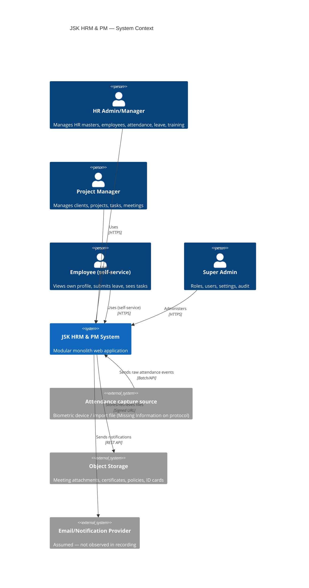
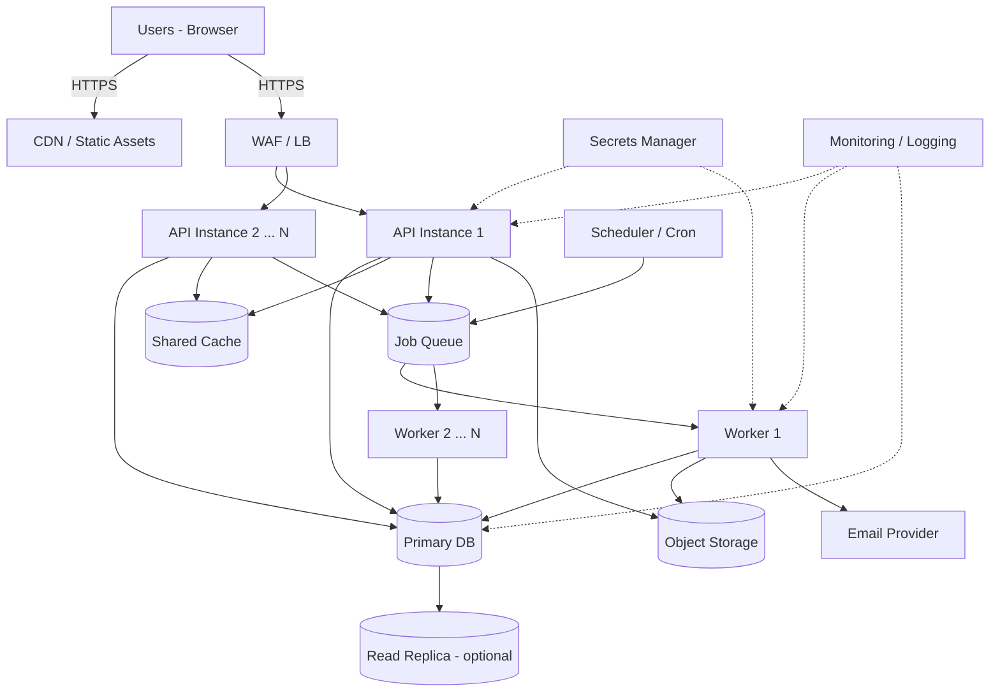

I will first perform requirement extraction and gap analysis. I will not design the architecture until the source document has been decomposed.

**Method note (read first):** All three uploaded files (`AI_Ready_Master_Build_Specification`, `AI_Ready_Master_Build_Specification_TEXT_ONLY`, `Project_Management_Developer_Specification`) were diffed. They are the **same underlying reconstruction specification** — the "TEXT_ONLY" and full versions are identical except for embedded screenshots, and the "Project_Management_Developer_Specification" is an earlier/shorter cut of the same document (identical through §21, missing §22–35 of the master build spec). So there is **one** source of truth, treated below as "the Spec." Where the Spec itself is inferential (it is a *reverse-engineered reconstruction from a 15-minute screen recording*, not a functional spec written by a product owner), I preserve that epistemic status rather than upgrading inferred behavior to fact — this matters because it changes how "Decision Required" vs "Assumption" should be read throughout: most gaps here exist because the *evidence* (the recording) is incomplete, not because a business analyst forgot to write something down.

Given the size of a fully exhaustive 31-phase treatment (the Spec's own §21 already lists ~20 screens as under-evidenced), this document prioritizes **architectural completeness with traceability** over mechanically listing every possible field-level FR. Every module, workflow, state machine, entity, and integration in the Spec is covered; granular field lists are preserved in tables rather than each being split into a separate FR-ID, and this consolidation is disclosed (not silent) — see §31.5.

---

# PHASE 1 — DOCUMENT DECOMPOSITION

## 1. Product / System Overview

- **Product purpose:** Reproduce (not redesign) an existing internal HRM + Project Management web application ("JSK HRM & Project Management System") to production-quality parity, based on a reverse-engineered UI walkthrough.
- **Primary business goal:** Enable a dev team / coding agent to rebuild the observed system with correct information architecture, workflows, validation, and calculations — not a look-alike static UI.
- **Secondary goals:** Make attendance/leave/project logic swappable via configuration; produce a system an auditor can trust (activity log, RBAC); leave a documented trail (`PARITY_GAPS.md`) of anything not provably observed.
- **Target users / personas:** HR administrators, HR managers, Project Managers, general employees (self-service, partially evidenced), Super Admin/system owner, read-only report viewers.
- **Internal users:** All of the above — this is an internal back-office system; no public/anonymous access is implied anywhere in the Spec.
- **External users:** None observed. Clients (customers of JSK) are *data subjects* referenced by Projects, not system users — the Spec never shows a client-facing login.
- **System boundaries:** Web application covering HR master data, employee lifecycle, attendance, leave, training, and project/task/meeting management, plus settings/audit. Payroll, recruitment/ATS, performance-review workflow detail, and biometric-device firmware are **out of scope** (referenced only as adjacent/likely-integrated concepts).
- **Explicitly out-of-scope (per Spec §1, §21):** original source code, DB schema, hidden APIs, and any business logic not visible/implied in the recording. Loan, Resignation, Notices, ID Card, HR Policies, Bulk Upload, Positions, Employee Type master, Transfer In/Out, Holiday CRUD, Leave Type CRUD fields, Short Leave, Training master/external certificate, Client List detail, Manage Task, Daily Tasks, Project Reports, and Software Setup are named as **under-evidenced**, not out of scope — they must still be built (Assumption/Recommendation-labeled).
- **Business dependencies:** Attendance calculation depends on Setup Rules + Holiday calendar; Leave balances depend on Leave Types + approval workflow; Project team membership depends on the Employee master (HRM is the system of record for people).
- **External dependencies:** An attendance-capture source (biometric device or import file) is *implied* but never shown as a live integration — `Missing Information`. File storage for meeting attachments (≤100MB) and (assumed) certificates/policies. Export tooling (CSV/Excel/Print).

## 2. Actor Inventory

| Actor | Type | Auth | Permissions (see full matrix §7) | Capabilities | Restrictions | Data read | Data write | Elevated actions |
|---|---|---|---|---|---|---|---|---|
| Super Admin | Internal, human | Username/password session | All | Full CRUD everywhere, role/user management, settings, audit deletion | None modeled | Everything | Everything | Delete audit logs, manage roles/users, global settings |
| HR Admin | Internal, human | Same | HR masters, employee, attendance, leave, training, HR reports | Full HR CRUD + leave approval + report export | No Settings/user mgmt (Assumption) | HR + own-module reports | HR domain entities | Approve leave, generate annual leave balances |
| HR Manager | Internal, human | Same | Operational HR approvals/reports; **limited** settings | Approve, report, limited config | Cannot alter global settings/roles (`Decision Required`: exact boundary vs HR Admin is unproven) | HR domain | Approvals, subset of masters | Leave approval |
| Project Manager | Internal, human | Same | Clients, projects, members, tasks, meetings, project reports | Full PM-domain CRUD | No HR module access (Assumption) | PM domain + assigned-employee names from HRM | PM domain entities | None |
| Employee (self-service) | Internal, human | Same | Own profile, own attendance/leave/tasks | View/submit own leave, view own attendance, view assigned tasks | Cannot see others' records; cannot approve | Own records only | Own leave application, own daily task entries (Assumption) | None |
| Viewer / Report User | Internal, human | Same | Read-only on granted modules | View/export reports | No create/edit/delete anywhere | Granted modules | None | None |
| Background job/scheduler (system actor) | Non-human | Service credential | Runs attendance recalculation, leave generation, exports | Automated, no interactive session | Cannot be impersonated by UI actions | Domain data it processes | Derived/calculated fields only | None — logs as "system" in Activity Log |
| Attendance capture source (device/import) | External system | `Missing Information` — no auth scheme observed | Feeds raw attendance events | Writes only to `attendance_events` | Must not be able to overwrite calculated fields directly | N/A | `attendance_events` (raw) only | None |

`Assumption`: A single "Employee" role is unproven from the recording (only an Admin session was observed — Spec §16 states this explicitly: *"The recording demonstrates an Admin account. Reconstruct role-based access control even if only one role was shown."*). All non-Super-Admin/HR-Admin roles in this table are the Spec's own recommended reconstruction, not observed fact.

## 3. Functional Requirement Inventory (representative, by module)

Full field-level detail for every screen is preserved in the module tables of the Spec (§4–§12) and is not repeated verbatim here to avoid a multi-thousand-row duplicate; each FR below is the authoritative *behavioral* requirement and cites which Spec fields it governs. Numbering is contiguous within a module; **Ambiguities** are called out per FR only where non-obvious.

### 3.1 Global Shell (FR-001–FR-006)
| ID | Requirement | Actor | Trigger | Main behavior | Validation/Business rules | Failure cases | Related |
|---|---|---|---|---|---|---|---|
| FR-001 | Persistent, collapsible sidebar with nested modules (HR, PM, Settings) and active-route highlighting | All authenticated | Any navigation | Route change updates highlighted item; expand state persists per session | N/A | Broken deep link → 404 page, sidebar still renders | FR-002 |
| FR-002 | Top bar shows page title, fullscreen toggle, avatar/username/role | All authenticated | Page load | Title bound to route metadata | N/A | — | — |
| FR-003 | All list/grid pages support server- or client-side sort, global search, filter, page-size selection, pagination, and preserve filter state across page changes | All authenticated w/ module read | Grid render/interaction | Query params reflect filter/sort/page state | Page size from fixed set (Assumption: 10/25/50/100) | Invalid page/filter → clamp to valid range, don't 500 | FR-004 |
| FR-004 | List pages expose CSV/Excel/Print export **using the currently applied filters** | Authenticated w/ read | Export click | Server streams file matching current query | Export must not silently include unfiltered rows | Export timeout on very large sets → background job (see Phase 9) | FR-003 |
| FR-005 | Every async action shows loading state and success/error feedback; failed writes preserve entered form data | All | Any mutating action | Optimistic UI disabled by default; show spinner, then toast/alert | N/A | Network failure ≠ silent no-op; must surface error and NOT clear the form | — |
| FR-006 | Destructive (delete) actions require a confirmation dialog | Users with delete permission | Delete click | Modal confirm before DELETE call fires | N/A | Cancel = no-op | FR-omitted-none |

### 3.2 HR — Departments / Sub-Departments (FR-010–FR-016)
Department CRUD (name required, active/inactive, recommended-unique name), Sub-Department CRUD with mandatory parent Department FK, same list/filter/export pattern as FR-003/004. `Ambiguity`: "recommended unique name validation" (Spec §4.1) is explicitly hedged — uniqueness enforcement (case-sensitivity, scope: global vs per-parent) is `Decision Required`.

### 3.3 HR — Setup Rules (FR-020–FR-024)
Create/list Setup Rule: Title, Employee Type (FK), Work Pattern (enum — only "Fixed" observed, others `Missing Information`), Daily Working Hour (decimal), Office Start/End Time, Grace Period (minutes), Active flag. **Business rule BR-010**: attendance calculation for any employee must resolve exactly one applicable Setup Rule for the attendance date (see §5 state machine / §27 calc spec). `Hidden Complexity`: rule *versioning* — if a rule's times change, do historical attendance days get recalculated retroactively? Not evidenced → `Decision Required`.

### 3.4 HR — Employee Management (FR-030–FR-045)
- FR-030: Employee list with 9 filter dimensions (Employee, Employee ID, Employee Type, Department, Designation, Blood Group, Contract Type, Gender, Marital Status), Find/Reset/Filter/Add actions, CSV/Excel export.
- FR-031: Multi-step wizard create (9 steps: Personal, Employee, Bank, Address, Emergency Contact, Academic, Extra-Curricular, Job Experience, Family) — see WF-002.
- FR-032: Step-level validation blocks progression; validation errors surface as a top red alert block AND (recommended) inline field errors.
- FR-033: Wizard state must persist across step navigation (no data loss going back/forward).
- FR-034: Final save must be transactional across all 9 sub-entities — partial employee records must not exist after a failed save (BR-011).
- FR-035: Inactive Employees list mirrors Employee list pattern, scoped to inactive status.
- FR-036: Employee Performance: two tabs (Performance list, Rating); performance record = employee + position snapshot + scoring lines + total score + evaluator + date; rating derived from score thresholds (`Missing Information`: exact thresholds).
- FR-037/038: Transfer Out / Transfer In lists — `Missing Information`: no fields evidenced beyond the tab existing; must be built from the general employee-history pattern (Recommendation) and flagged in `PARITY_GAPS.md`.

### 3.5 Attendance (FR-050–FR-060)
- FR-050: Attendance Form — Employee (required), Time (required datetime), "Employee ID Show" modal (device-ID↔employee mapping), Bulk Insert, Submit → creates a raw `attendance_events` row (not a calculated day).
- FR-051: Monthly Attendance manual entry — Employee, Year, Month, Time In, Time Out → creates/updates a day-level record for the given month context. `Ambiguity`: does this write directly to the calculated `attendance_days` table, or synthesize two raw events? Recommendation: synthesize raw events, then recalculate, to keep raw data as system of record (BR consistency with FR-034-style transactional integrity).
- FR-052: Missing Attendance queue — scheduled working days with no qualifying event pair.
- FR-053: Pending Attendance queue — records awaiting approval/processing. `Missing Information`: exact approval action set (approve/reject/edit) not evidenced from recording beyond the tab existing.
- FR-054–060: Attendance Reports (Late Attendance, Attendance Log, Daily Present, Monthly Summary, Monthly Attendance detail, Employee Daily Worksheet) — each filterable by employee/year/month at minimum, CSV/Excel/Print export using active filters, computed per §27 calculation spec.

### 3.6 Holiday (FR-065)
Holiday calendar CRUD: title, date/range, type, description, active flag. Used by attendance ("Holiday Present") and leave. Full field set is `Missing Information` beyond what's Recommended here (Spec §7 explicitly reconstructs, doesn't observe, this screen).

### 3.7 Leave (FR-070–FR-080)
- FR-070: Leave application list — filter by employee, create, CSV/Excel export; columns: employee, leave type, dates, days, reason, approval dates, approved days, hard-copy flag, manager comments, status, actions.
- FR-071: Leave approval workflow — Pending → Approve/Reject (see state machine SM-3 / WF-006).
- FR-072: Employee Total Leaves — annual balance matrix per employee/year with Total/Taken/Due triplets per leave category (Monthly, Non-Paid, Paternity, Maternity, Annual, Sick, +more `Missing Information` beyond visible viewport).
- FR-073: "Generate Leaves for [year]" — must be **idempotent** per employee+leave-type+year (BR-020) — cannot double-allocate.
- FR-074: Leave Types CRUD (name, code, annual entitlement, paid/unpaid, gender eligibility, carry-forward rule, max consecutive days, document requirement, active) — `Missing Information`: field set is Spec's own Recommendation, not observed.
- FR-075: Short Leaves — partial-day/time-based leave tracked separately from full-day leave. `Missing Information`: unit (hours vs half-day), max per period, approval flow — none evidenced.

### 3.8 Training (FR-085–FR-090)
Training master (title, description, trainer, schedule, venue, status), Training Assignment (training, employee, assigned date, completion date, status, score), Internal/External Certificate (attachment metadata, issue/expiry date, source). `Missing Information`: certificate file-type/size limits (unlike Meeting attachments, no limit was observed for certificates).

### 3.9 Other HR (FR-095–FR-099)
Loan, Resignation, Notices, ID Card, HR Policies, Bulk Upload — **all under-evidenced** (Spec §21). Each gets a Recommendation-level field set (see module tables in Spec §10) and must be flagged in `PARITY_GAPS.md` per the Spec's own Definition-of-Done (§33).

### 3.10 Project Management (FR-100–FR-120)
- FR-100: Project Dashboard — Project Task Status chart, Projects table (Name, Client, Lead, Progress, Start/End, Status, Duration Progress, State, Action), Add New Project / Manage Projects actions.
- FR-101: Project create/edit — Name, Client (selectable or inline-created via "Add Client"), Team Members (multi-select from Employee master), Approximate Tasks (int), Summary, Start Date, Duration (days), Ending Date (derivable), Status (observed default "Open").
- FR-102: Client CRUD — independent entity so Projects can reference it; inline creation from the project modal.
- FR-103: Tasks — project FK, title, description, assignee(s), priority, planned start/end, actual completion, status, progress %, estimated hours, attachments. `Missing Information`: full field/state set not evidenced ("Manage Task" listed as under-evidenced, §21).
- FR-104: Daily Tasks — employee work-log entries: date, project/task, work description, hours, status. `Missing Information` on exact fields.
- FR-105: Meetings — Project (required), Meeting Place (required), Meeting Held (required datetime), Team Members (multi-select), Purpose (required), Outcomes (required), Attachment (optional, ≤100MB; accepted types mp4/mov/avi/doc(x)/pdf/xls(x)/ppt(x)/txt/zip), Close/Create actions.
- FR-106: Project Reports — by project/client/team member/date range/status: progress, task-status distribution, employee task/work summaries, duration progress, meeting history.

### 3.11 Settings & Activity Log (FR-130–FR-134)
- FR-130: Activity Log lists Date, Log Name (source module/action), Description, Done By, Action(delete).
- FR-131: Row multi-select + "Delete Selected Items."
- FR-132: Filter/search/page-size/sort/pagination on the log.
- FR-133 (Recommendation, elevated to **must**): restrict audit-log deletion to Super Admin; strongly recommend making the log **immutable** in production (append-only), which conflicts with the observed "delete" affordance — flagged as **Contradiction** in Phase 2.
- FR-134: Software Setup screen exists in navigation; content entirely `Missing Information`.

## 4. Non-Functional Requirement Inventory

**Explicitly stated (Spec §32, §18, §19, §26):**
- NFR-001 (Security): CSRF protection, secure session/token handling, password hashing, server-side authorization on every mutation, upload validation (extension/MIME/size/authorization).
- NFR-002 (Performance): indexed queries, server-side pagination for large employee/attendance tables, interactive list-page load.
- NFR-003 (Reliability): transactional writes for employee wizard, leave approval + balance update, multi-entity project creation.
- NFR-004 (Accessibility): keyboard-accessible forms/modals, labels, visible focus, semantic tables, adequate contrast.
- NFR-005 (Responsive): desktop parity with recording; usable (not necessarily pixel-identical) tablet/mobile without data loss.
- NFR-006 (Observability): structured server logs, actionable error responses, audit log for business mutations.
- NFR-007 (Localization): centralized date/time/number/text so Bangla/English can be added without schema change.
- NFR-008 (Data types): UUID/bigint PKs consistently, decimal (never float) for money/score/hours, timezone-aware timestamps, ISO dates in API, controlled-vocabulary status fields, soft delete for employees/projects/business records, `created_at`/`updated_at`/actor on significant mutations.
- NFR-009 (File limits): meeting attachment ≤100MB, restricted extension allow-list.
- NFR-010 (Testability — Spec §33): automated tests must cover auth, major CRUD, attendance calculation, leave balance generation/approval, project creation; no console errors/broken routes on documented happy paths.

**Architecturally inferred (not stated by Spec — flagged as such):**
- NFR-101 `Inferred`: Availability target — not stated; internal back-office tool, so business-hours-weighted uptime (e.g., 99.5%) is a reasonable **Recommendation**, not a documented SLA.
- NFR-102 `Inferred`: Multi-tenancy — the Spec shows a single organization; nothing suggests SaaS multi-tenant isolation is needed. Treated as **single-tenant** unless a `Decision Required` below is resolved otherwise.
- NFR-103 `Inferred`: Data residency/compliance regime (GDPR/local labor-data law) is never mentioned — flagged as `Decision Required`, especially given employee PII (bank details, DOB, family members) is collected.
- NFR-104 `Inferred`: Concurrent user scale — no number given; capacity model in Phase 18 is parameterized rather than fabricated.
- NFR-105 `Inferred`: Backup/DR RPO/RTO — not stated (`Decision Required`, Phase 23).

## 5. Business Rule Inventory (selected — full set embedded in workflow tables)

| ID | Rule |
|---|---|
| BR-001 | Department Name should be unique (Spec hedges as "recommended") — scope of uniqueness `Decision Required`. |
| BR-002 | An employee has exactly one applicable Setup Rule per attendance date. |
| BR-003 | Employee wizard save is all-or-nothing across the 9 sub-forms (FR-034). |
| BR-004 | Attendance "Late" = actual first valid check-in > scheduled start + grace period. |
| BR-005 | "Absent" = scheduled working day, no qualifying attendance, no approved leave/holiday exception. |
| BR-006 | "Holiday Present" = attendance exists on a configured holiday date. |
| BR-007 | Raw attendance events are never overwritten by calculation; derived days must be recalculable. |
| BR-008 (=BR-020 above) | "Generate Leaves for [year]" is idempotent per employee+type+year. |
| BR-009 | Leave balance: Due = Total − Taken, and only **approved** leave consumes balance unless policy explicitly reserves pending leave (`Decision Required` on default). |
| BR-010 | Leave rejection must not touch the balance. |
| BR-011 | Leave administrative correction after approval requires elevated permission and must reverse-then-reapply the balance change (not a raw edit). |
| BR-012 | Date ordering constraints: contract end ≥ joining date; project ending ≥ start; leave end ≥ leave start; end date ≥ start date generally. |
| BR-013 | Meeting attachment ≤100MB and restricted extension allow-list. |
| BR-014 | Project duration/ending-date must have exactly one canonical derivation direction (start+duration→end, or explicit end validated ≥ start) — `Decision Required` on which is authoritative when both are entered. |
| BR-015 | Project/Task progress aggregation strategy (task-count-complete vs weighted progress-%) is unproven — `Decision Required`, default Recommendation: simple average of task progress %. |
| BR-016 | Activity Log entries are created for every create/update/delete mutation across business modules, capturing actor + timestamp + description. |
| BR-017 | Audit-log deletion is restricted to Super Admin (tension with "should be immutable" — see Contradiction C-01). |

## 6. Workflow Inventory (major flows)

**WF-001 — Authentication & Session**
Actor: any user. Entry: login page. Preconditions: valid credentials. Happy path: submit credentials → server validates → session/token issued → redirect to dashboard. Alternate: "remember me" (`Missing Information` — not evidenced, Recommendation only). Failures: invalid credential → generic error (avoid user enumeration); locked-out account after N attempts (`Decision Required` on threshold) → rate-limited. Recovery: password reset flow (`Missing Information` — not observed, must be built to a reasonable standard per NFR-001). Side effects: Activity Log "login"/"failed login" entries (Phase 24). Final state: authenticated session.

**WF-002 — Employee Onboarding (Wizard Create)**
Actor: HR Admin/HR Manager. Entry: Employee List → "Add Employee." Preconditions: department/sub-department/position/employee-type/setup-rule masters exist. Steps: 9 wizard stages (§3.4). Validation failure: block stage advance, show consolidated + inline errors. Partial failure: none allowed — DB transaction wraps final save (BR-003). Duplicate request (double-submit): submit button must disable on first click / use idempotency key (`Recommendation`, not observed). Cancellation: navigate away — Decision Required whether draft is persisted or discarded (Recommendation: discard, no draft persistence, since none observed). Final state: employee created, `employees.status = Active`. Side effects: Activity Log "Employee created."

**WF-003 — Attendance Capture (Manual)**
Actor: HR Admin, or automated device feed (system actor). Entry: Attendance Form. Steps: select employee, enter/receive timestamp → write raw `attendance_events` row → (async or sync) recalculation touches the affected `attendance_days` row. Failure: unknown employee ID from device import → routed to a reconciliation/error queue, not silently dropped (`Recommendation`). Duplicate event: idempotent on (employee, device timestamp) pair (`Recommendation` — not evidenced, but necessary to prevent double-counted work time). Retry: device import retried with same batch → must not duplicate (`Recommendation`). Final state: `attendance_days` recalculated for the affected date.

**WF-004 — Bulk Attendance Insert**
Actor: HR Admin. Entry: "Bulk Insert" on Attendance Form. `Missing Information`: file format, column mapping, and per-row validation/error-reporting UX are unproven. Recommendation: CSV template with per-row validation results (mirrors Bulk Upload pattern in §10), executed as a background job (Phase 9) with a downloadable error report.

**WF-005 — Monthly Attendance Recalculation (scheduled/triggered)**
Trigger: nightly cron, OR ad hoc when a Setup Rule/Holiday/Leave affecting a past date changes. Behavior: recompute derived status per §27 rules from raw events, without mutating raw events. Idempotent by design (pure function of raw inputs). Failure: partial batch failure → per-employee-day granularity retry, not whole-batch rollback (keeps unaffected employees correct).

**WF-006 — Leave Application & Approval**
Actor: employee (submitter, self-service) or HR Admin on their behalf; HR Admin/Manager (approver). Entry: Leave list → "Add Leave Application." Steps: submit (Draft→Pending, BR validates type/dates/duration against remaining balance — `Decision Required`: is over-balance submission blocked or allowed-with-warning?) → approve (Pending→Approved, consumes balance BR-009) or reject (Pending→Rejected, no balance effect). Failure: insufficient balance at approval time (balance changed between submit and approve) → must re-validate at approval, not just at submit. Cancellation: employee withdraws a Pending request (`Missing Information` — not evidenced but standard; Recommendation: allow withdrawal only while Pending). Final states: Approved / Rejected / (soft-deleted). Side effects: Activity Log, balance recalculation.

**WF-007 — Annual Leave Generation**
Actor: HR Admin. Entry: "Generate Leaves for [year]" button on Employee Total Leaves. Preconditions: Leave Types configured with entitlement rules. Behavior: for each eligible active employee × leave type, create a balance row if one doesn't already exist for that year (BR-008 idempotency). Partial failure: must not leave some employees generated and others not without a clear resumable state — Recommendation: wrap as one transaction per employee (not one giant transaction) so a single bad employee record doesn't block the whole cohort, and report failures.

**WF-008 — Training Assignment & Completion**
Actor: HR Admin (assign), employee/trainer (complete — `Missing Information` on who marks completion). Steps: assign training to employee(s) → status transitions Assigned→In Progress(optional)→Completed, with completion date + score recorded.

**WF-009 — Project Creation with Inline Client**
Actor: Project Manager. Entry: "Add New Project." Steps: fill project fields; if client doesn't exist, "Add Client" inline-creates a Client record without leaving the modal → then continue project save. Failure: inline client creation fails validation → surfaced inside the still-open project modal, project not partially created. Final state: `projects.status = Open` (default), team members linked (project_members).

**WF-010 — Meeting Creation with Attachment**
Actor: Project Manager. Steps: fill required fields (project, place, held datetime, purpose, outcomes), optional attachment upload (validated client- and server-side against BR-013), team members multi-select → Create. Failure: attachment exceeds 100MB or disallowed extension → rejected before/at upload with actionable message, not after a long upload (Recommendation: client-side pre-check + authoritative server-side re-check).

**WF-011 — Activity Log Review & Deletion**
Actor: Super Admin (delete), any granted Viewer (read). Steps: filter/search log → optionally multi-select → "Delete Selected Items" (restricted). **Note:** this workflow directly creates Contradiction C-01 (see Phase 2) between the observed delete affordance and the Spec's own immutability recommendation.

**WF-012 — Bulk Upload (HR masters, generic)**
`Missing Information` end-to-end (Spec §10, §21). Recommendation pattern (same as WF-004): template → validate → per-row error report → commit only valid rows (or all-or-nothing, `Decision Required`).

## 7. State Machines

**SM-1: Attendance Day** (derived, not directly user-editable)
States: `NoData → Present | Late | Absent | HolidayPresent | Missing`. Transitions are computed, not user-initiated, from raw events + Setup Rule + Holiday + approved Leave, per §27. `Missing` is a distinct terminal-until-corrected state requiring a raw-event fix, which then re-triggers recalculation (WF-005). No manual transition to `Present` without a qualifying event — this must not be a free-text status field (BR-007 spirit).

**SM-2: Leave Application** (Spec §28, reproduced with elaboration)
```
Draft/New --submit--> Pending
Pending --approve--> Approved   [consumes balance, BR-009]
Pending --reject--> Rejected    [no balance effect]
Pending --withdraw(employee)--> Withdrawn   [Recommendation, not observed]
Approved --admin correction (elevated perm)--> Approved (recalculated)  [reverse+reapply balance]
Approved | Pending | Rejected --soft delete (admin)--> Deleted [preserves audit trail]
```
Invalid transitions: Approved→Pending (must go through explicit correction, not silent revert); Rejected→Approved (must be a new submission, not a status flip) — `Decision Required` if the business actually wants a re-open path.

**SM-3: Employee Lifecycle**
```
(create wizard) --> Active
Active --resignation approved--> Inactive (feeds Inactive Employees list, WF for Resignation is Missing Information)
Active --transfer out--> Inactive-at-origin / re-created or updated at destination (Transfer In/Out fields are Missing Information — exact mechanism, e.g. same record moved vs new record, is a Decision Required)
Active|Inactive --admin edit--> unchanged state
Active --soft delete--> Deleted (Recommendation: preserve for audit; hard delete not recommended)
```

**SM-4: Project**
```
Open --> InProgress --> Completed
Open|InProgress --> OnHold --> InProgress
Open|InProgress|OnHold --> Cancelled
```
`Missing Information`: only "Open" was observed as a default; the full enum (`InProgress`/`Completed`/`OnHold`/`Cancelled`) is a Recommendation extension, not proven — flagged explicitly per the Spec's own instruction ("extend only when additional evidence/configuration exists").

**SM-5: Task** (`Missing Information` — no states directly observed; Recommendation, standard kanban-style)
```
ToDo --> InProgress --> Review(optional) --> Done
Any --> Blocked --> (previous state)
```

**SM-6: Training Assignment**
```
Assigned --> InProgress(optional) --> Completed [records score + completion date]
Assigned --> Cancelled (Recommendation)
```

## 8. Integration Inventory

| Integration | Purpose | Direction | Data | Auth | Style | Sync/Async | Notes |
|---|---|---|---|---|---|---|---|
| Attendance capture device/import | Feed raw check-in/out events | Inbound | employee device-ID, timestamp | `Missing Information` | File import (CSV) and/or biometric device push — both plausible, neither confirmed | Async batch preferred | Must map device ID → employee via the observed "Employee ID Show" concept; unmapped IDs go to a reconciliation queue |
| File/object storage | Meeting attachments, certificates, policies, ID card assets | Outbound (app→storage) | Binary files + metadata | Server-side credential, never exposed to browser directly | Signed URL preferred | Sync upload, async virus scan (Recommendation) | No specific provider evidenced — architecturally abstracted (Phase 11) |
| Export/print rendering | CSV/Excel/PDF generation | Internal | Filtered report data | N/A (internal) | Library-based | Sync for small sets, async+notify for large (Recommendation) | — |
| Email (assumed, not observed) | Password reset, notices, leave-status notification | Outbound | Recipient, template, payload | Provider API key | REST | Async, queued | `Missing Information` — no notification screen was observed at all; entire Phase 14 here is therefore Recommendation-level, clearly marked |

No payment gateway, no SSO/IdP, no payroll integration, no third-party HRIS sync are evidenced anywhere in the Spec — explicitly **not** invented here.

## 9. Data Inventory

The Spec's own §13 proposed data model is the base; expanded with lifecycle/sensitivity/ownership columns.

| Entity | Owner module | Sensitivity | Lifecycle | Source of truth | Read | Write |
|---|---|---|---|---|---|---|
| users, roles, permissions | Settings/Auth | High (credentials) | Created by Super Admin, soft-deleted | Auth module | Self + Super Admin | Super Admin (roles), self (password) |
| departments, sub_departments | HR masters | Low | CRUD, soft-delete | HR module | All authenticated | HR Admin |
| employee_types, positions, setup_rules | HR masters | Low | CRUD | HR module | All authenticated | HR Admin |
| employees (+ banks/addresses/emergency/academic/experience/family/activities) | HR | **High** (PII, bank details, DOB, family) | Wizard-created, updated, soft-deleted on resignation/transfer | HR module | HR roles; self (own record) | HR Admin/Manager; self (limited fields, self-service) |
| attendance_events (raw) | Attendance | Medium | Append-only, immutable once written | Attendance module / capture source | HR roles | Attendance module + capture source only |
| attendance_days (derived) | Attendance | Medium | Recomputed, never manually free-typed | Attendance module (computed) | HR roles, self | System (calculation service) only |
| holidays | HR masters | Low | CRUD | HR module | All | HR Admin |
| leave_types | HR masters | Low | CRUD | HR module | All | HR Admin |
| leave_balances | Leave | Medium | Generated yearly, updated on approval | Leave module | HR roles, self | Leave approval workflow (system-mediated), HR Admin (correction) |
| leave_applications | Leave | Medium (reason text) | State machine SM-2 | Leave module | HR roles, self (own) | Self (create), HR roles (approve/reject) |
| trainings, training_assignments | Training | Low/Medium | CRUD | Training module | HR roles, self (own assignment) | HR Admin |
| clients | PM | Medium (business contact info) | CRUD | PM module | PM roles | Project Manager |
| projects, project_members | PM | Medium | SM-4 | PM module | PM roles, assigned employees (read) | Project Manager |
| tasks, daily_tasks | PM | Low/Medium | SM-5 | PM module | PM roles, assignee | Project Manager, assignee (own daily tasks) |
| meetings (+ attachments) | PM | Medium (attachment content varies) | CRUD | PM module | PM roles, invited members | Project Manager |
| activity_logs | Settings/Audit | **High** (security-relevant) | Append-only (Recommendation), delete restricted | System (auto-generated) | Granted roles | System only (never user-authored); deletion restricted to Super Admin |

---

# PHASE 2 — REQUIREMENT GAP ANALYSIS

## Missing Information
- MI-01: Password policy, MFA, account-recovery flow, session timeout/refresh — no login/security screen was in the recording at all.
- MI-02: Attendance capture source protocol (device push vs file import vs both) and its authentication.
- MI-03: Notification channel(s) — no email/SMS/in-app notification screen observed; whether leave approval, meeting invite, or training assignment trigger any notification is unproven.
- MI-04: Exact field sets for Loan, Resignation, Notices, ID Card, HR Policies, Bulk Upload, Positions, Employee Type master, Transfer In/Out, Holiday CRUD, Leave Type CRUD, Short Leave, Training master/external certificate, Client List detail, Manage Task, Daily Tasks, Project Reports, Software Setup (all listed by the Spec itself, §21).
- MI-05: RPO/RTO, uptime target, concurrent-user scale, data-residency/compliance regime.
- MI-06: Bank/employee-history sub-form field-level constraints (which of the 9 wizard steps are mandatory vs optional beyond Personal Information's validated set).

## Ambiguities
- AM-01: Department/rule name "recommended unique" — case sensitivity, scope (global vs. per parent) unresolved.
- AM-02: Whether Setup Rule changes retroactively recalculate historical attendance.
- AM-03: Whether pending leave reserves balance or only approved leave does (Spec states "unless the business explicitly reserves pending leave" — leaves the default open).
- AM-04: Project ending-date vs duration — which is authoritative when both are supplied.
- AM-05: Task/Project progress aggregation formula.
- AM-06: Employee uniqueness of email across employees ("configurable if employees can share organizational aliases" — Spec's own hedge).

## Contradictions
- **C-01:** Spec §12 shows an observed "Delete" action on individual Activity Log rows and a "Delete Selected Items" bulk action, but Spec §12's own recommendation says "production systems commonly make audit logs immutable." These are in tension. **Resolution used in this architecture:** implement the observed UI affordance but restrict it to Super Admin, and make the underlying storage **soft-delete with retention** (application-level "hide," not physical `DELETE`), with all deletions of audit rows themselves separately audited in an immutable secondary log. This is flagged as a Decision Required for the product owner to confirm, not silently resolved.
- **C-02 (minor):** Spec calls Employee ID "unique, indexed business identifier" (§26) while also describing device-mapped "#ID" in the Attendance module (§5) — unclear if these are the same identifier or two different ID spaces (HR employee ID vs. attendance-device ID). Treated as **two distinct fields** (`employees.employee_code` vs `attendance_events.device_employee_id` with a mapping table) to avoid silently merging them.

## Hidden Complexity
- HC-01: "Recalculate attendance without overwriting raw events" (BR-007) looks like a one-line rule but requires an idempotent, replayable calculation service, an event-sourcing-flavored data model for attendance, and careful transaction boundaries whenever a Setup Rule/Holiday/Leave changes retroactively (Phase 5, Phase 9).
- HC-02: "Generate Leaves for [year], idempotent" (BR-008) implies per-employee-per-type-per-year uniqueness constraints plus a re-runnable, partially-resumable batch job — not a simple insert.
- HC-03: The 9-step transactional employee wizard (BR-003) spans 9+ tables in one commit; under concurrent HR-Admin usage this needs row-level locking/optimistic concurrency to avoid partial-duplicate creation on double submit.
- HC-04: Filtered exports "using the currently applied filters" (FR-004) means the export path must share exact query logic with the list endpoint — a common source of silent drift bugs if implemented as two separate code paths.
- HC-05: Meeting attachments up to 100MB imply the naive "upload through the app server" pattern will be slow/costly at scale — direct-to-storage signed uploads are architecturally necessary, not optional (Phase 11).

## Decisions Required
| ID | Question | Why it matters | Risk if unresolved | Recommended default |
|---|---|---|---|---|
| DR-01 | Is pending leave balance-reserving? | Changes leave balance calc and UI messaging | Employees could over-request leave that later can't be honored | Default: **reserve** balance at submission (safer), release on reject/withdraw |
| DR-02 | Audit log physical delete vs soft-delete-only? | Compliance/forensics posture | Irrecoverable tampering of security records | Soft-delete + secondary immutable meta-audit (C-01 resolution) |
| DR-03 | Attendance capture protocol | Determines an entire integration adapter | Building the wrong adapter shape | Build a pluggable adapter interface (file-import first, device-push adapter added later) |
| DR-04 | Data residency / compliance regime | Determines DB region, retention law | Legal exposure holding PII (bank info, family data) | Assume single-region deployment near primary user base; revisit if regulated |
| DR-05 | Uptime/RPO/RTO targets | Infra sizing, on-call posture, backup schedule | Under/over-engineering | Internal tool default: 99.5% business-hours uptime, RPO 24h, RTO 4h (Phase 23) |
| DR-06 | Setup Rule retroactive recalculation | Data correctness after policy edits | Historical reports silently wrong or unexpectedly changing | Default: rule changes apply prospectively only; retroactive recalculation is an explicit admin action, not automatic |

---

# PHASE 3 — ARCHITECTURAL DRIVERS

| Driver | Related IDs | Why it matters | Architectural consequence | Tradeoffs |
|---|---|---|---|---|
| Transactional multi-entity writes (employee wizard, project+client, leave approval+balance) | FR-034, BR-003, BR-009, HC-03 | Data integrity across many tables in one user action | Strong consistency, single relational DB with ACID transactions per write; avoid distributed-transaction patterns | Limits horizontal write-sharding later, but correctness > premature scale |
| Derived/recalculable attendance data | BR-004–007, HC-01 | Core business value (accurate reports) depends on a pure, replayable calculation | Separate raw-event store from derived-state store; dedicated calculation service invocable both sync (single day) and batch (recalculation job) | Adds a layer vs. "just store the status," but prevents unrecoverable data loss |
| Reporting/export breadth (10+ report types, filter-consistent exports) | FR-003/004, HC-04 | Reports are a primary deliverable, not an afterthought | Shared query/filter layer between list APIs and export APIs; read-optimized indexes; async export for large sets | More upfront design than ad hoc per-report SQL, but avoids drift bugs |
| Large file attachments (≤100MB) | BR-013, HC-05 | Naive server-proxied uploads don't scale and stress app servers | Direct-to-object-storage signed uploads; app server only issues/validates the signed URL and records metadata | Requires object storage from day one even at small scale |
| RBAC across 6 role concepts with self-service scoping | Actor Inventory, §16 | Wrong access model = major security/compliance risk | Role + resource-ownership hybrid (RBAC + ownership checks for "own record" cases), enforced server-side on every mutation (NFR-001) | More permission-check code than a flat role check, but required for the "own profile only" pattern |
| Idempotent scheduled/batch operations (leave generation, attendance recalculation, bulk import) | BR-008, HC-01, HC-02 | Batch jobs will be re-run (manually or by retry) — must not corrupt data | Uniqueness constraints at DB level + job-level idempotency keys; per-record failure isolation instead of all-or-nothing batches | Slightly more complex job design than naive loops |
| Internal-tool scale (no evidence of high traffic, no multi-tenancy) | NFR-101–104 | Avoid over-engineering | Modular monolith over microservices (Phase 4); no need for global distribution | Must still design module boundaries cleanly so a future split is possible if the org grows |
| Immutable/near-immutable audit trail vs. observed delete UI | C-01 | Compliance and trust in the system of record | Soft-delete + secondary meta-audit design (Phase 24) | Slightly more storage, but preserves forensic integrity |

---

# PHASE 4 — SYSTEM ARCHITECTURE

## Architecture style decision

**Chosen: Modular Monolith**, not microservices, not serverless-first, not full event-driven.

Rationale, tied to drivers above: this is a single-organization, internal back-office system (NFR-101/102) with strongly transactional cross-entity writes (employee wizard, leave approval+balance, project+client) that are *much* simpler and safer inside one ACID database/transaction boundary than across service boundaries. There is no evidenced requirement for independent scaling of, say, "Attendance" vs "Projects" at different rates, no multi-team-ownership signal, and no geographic distribution requirement. A modular monolith with clearly separated internal modules (mirroring the Spec's own module boundaries: HR, Attendance, Leave, Training, Project Management, Settings/Audit) gives transactional simplicity now and a credible seam to extract services later (e.g., Attendance calculation could become its own service if device-integration volume grows — Phase 9 already isolates it behind an internal service boundary in anticipation of that).

A thin **event-driven internal layer** (in-process or lightweight queue) is used *only* where async is architecturally required — file processing, bulk import, large export, notifications, scheduled recalculation (Phase 9) — not as a general pattern.

## 1. System Context (Mermaid)



## 2. Container / Service Architecture

| Component | Responsibilities | Requirements owned | APIs exposed | APIs consumed | Data owned | Scaling | Failure characteristics | Deployment |
|---|---|---|---|---|---|---|---|---|
| Web SPA (frontend) | Renders shell, all module UIs, wizard, tables, exports UI | FR-001–006, all module UIs | — | Backend REST API | None (client state only) | Stateless, CDN-served | Fails gracefully to cached shell; API errors surfaced per FR-005 | Static asset build + CDN |
| API/App Server (modular monolith) | AuthN/Z, CRUD, workflow orchestration, validation | Almost all FR/BR | REST (Phase 6) | Object storage, email provider | Owns all relational data via ORM/repositories | Horizontally scalable (stateless, sessions in shared store) | Individual instance failure → load balancer routes around it | Containerized, N replicas behind LB |
| Attendance Calculation Service (internal module, isolated boundary) | Recalculation engine (§27), consumes raw events | BR-004–007, HC-01 | Internal (called by API + job runner) | DB | `attendance_days` (derived) | CPU-bound batch scaling via job workers | Isolated failure doesn't take down CRUD APIs; retried per-employee-day | Same deployable as API server initially; extractable later |
| Job/Worker process | Bulk import, recalculation, large export, leave generation, notification dispatch | HC-01–05, WF-004/005/007 | Consumes internal queue | DB, storage, email | Job status table | Scales by worker count | Poison messages → DLQ (Phase 9) | Separate container/process from API, same image |
| Relational Database | System of record | All data-owning FRs | — | — | Everything (Phase 5) | Vertical + read replicas | Primary failure → managed failover | Managed RDBMS |
| Object Storage | Files/attachments | BR-013, FR-105 | Signed URL upload/download | — | Binary blobs + metadata pointer in DB | Provider-managed | Provider-managed | Managed object storage |
| Cache (optional, Phase 13) | Session store, hot read caching | NFR-002 | — | — | Ephemeral | Managed | Fail-open to DB (Phase 13) | Managed cache |

## 3. Internal Module Architecture (inside the App Server)

- **auth**: login/session/token issuance, password hashing, brute-force protection.
- **authorization**: RBAC/ownership policy evaluation, permission matrix (Phase 7).
- **hr-masters**: departments, sub-departments, employee types, positions, setup rules, holidays.
- **employee**: employee CRUD + 9 wizard sub-entities, inactive/transfer lifecycle.
- **attendance**: raw event ingestion, calculation service boundary, reports.
- **leave**: leave types, applications, balances, generation job trigger.
- **training**: training master, assignments, certificates.
- **project-management**: clients, projects, project_members, tasks, daily_tasks, meetings, PM reports.
- **files**: signed upload/download issuance, MIME/size/extension validation, metadata.
- **notifications** (Recommendation-level, MI-03): email/in-app dispatch abstraction.
- **audit**: activity log writer (cross-cutting — every module publishes to it), reader, restricted deletion.
- **admin/settings**: role/user management, software setup.
- **scheduling**: cron-style job trigger registry (recalculation, leave generation, cleanup).

Each module exposes an internal service interface; modules do not reach into each other's tables directly (e.g., `project-management` reads employee names via the `employee` module's read API, not a raw join across module-owned schemas) — this is what preserves the option to extract a module into its own service later.

## 4. Frontend Architecture

- **Applications:** one authenticated SPA (or server-rendered app) covering HR + PM + Settings; no separate public app (none observed), no separate mobile app (responsive web only, NFR-005).
- **Module boundaries:** mirror backend modules (routes: `/hr/*`, `/projectmanagement/*`, `/activity-log`, `/settings/*`), matching the Spec's own observed routes (§20) exactly for P0 parity.
- **State management:** server state (lists, entities) via a query/cache library (e.g., React Query-style) with cache keys including active filters, to satisfy FR-003/004's "preserve filter state" and "export matches filters" requirements from one source of truth; local/UI state (wizard step, modal open) in component state.
- **Session handling:** token or cookie-session (Phase 7); silent refresh; redirect-to-login on 401.
- **Permissions/UI authorization:** route guards + component-level permission checks driven by the same permission matrix the backend enforces — **UI-side checks are convenience only; server is authoritative** (NFR-001).
- **Form architecture:** schema-based validation (mirrors server validation rules) with both inline field errors and a consolidated top alert, matching the observed Employee Create pattern (FR-032).
- **Upload architecture:** client requests a signed URL from `files` module, uploads directly to object storage, then confirms metadata with the API (Phase 11) — required for the 100MB meeting attachments (HC-05).
- **Real-time updates:** none observed/required; standard request/response with manual refresh or polling on report pages is sufficient (`Decision Required` if live dashboards are wanted later).
- **Localization:** all user-facing strings and date/number formatting centralized (NFR-007), even though only English is evidenced.
- **Accessibility:** per NFR-004, built into the shared component library (buttons, modals, tables) rather than per-page.
- **Feature flags:** used to gate P2/Recommendation-level features (e.g., under-evidenced screens) so they can ship disabled until validated against real legacy behavior.

---

# PHASE 5 — DATA ARCHITECTURE

## Database Strategy

- **Technology:** single relational database (PostgreSQL recommended — strong transactional guarantees, mature JSON support for the inevitable "extra fields we're not sure about yet" columns, good migration tooling). Chosen over NoSQL because nearly every core workflow (employee wizard, leave+balance, project+client) is fundamentally relational and transactional (Phase 3 driver).
- **Data ownership:** each internal module owns its tables; cross-module reads go through module service interfaces, not cross-schema joins, to keep the monolith's internal seams service-extractable later.
- **Transaction boundaries:** one DB transaction per user-initiated write operation that spans multiple tables (employee wizard save, project+inline-client, leave approve+balance update). Batch jobs (leave generation, recalculation) use **one transaction per unit of work** (per employee, per employee-day) rather than one giant transaction, per HC-02/HC-01 partial-failure isolation.
- **Consistency:** strong consistency (single primary DB) for all writes. Read replicas (if needed at scale) serve reports/exports, tolerating brief replication lag — acceptable because reports are inherently "as-of" snapshots.
- **Partitioning/sharding:** not needed at evidenced scale; `attendance_events`/`attendance_days` are the highest-volume tables and are natural candidates for time-based partitioning (by year/month) if/when volume warrants it — noted as a scaling lever (Phase 18), not built day one.
- **Indexing strategy:** every FK indexed; composite indexes on common filter combinations (e.g., `employees(department_id, status)`, `attendance_days(employee_id, date)`, `leave_balances(employee_id, year, leave_type_id)` unique index for BR-008 idempotency); full-text/trigram index for name/global search fields.
- **Migration strategy:** versioned, forward-only migrations (per Definition of Done §33: "no manual database editing"); seed scripts separate from migrations.

## Entity Model (Mermaid ER — core; sub-entities of employee condensed for readability, full list in Phase 1 §9)

```mermaid
erDiagram
    DEPARTMENT ||--o{ SUB_DEPARTMENT : has
    DEPARTMENT ||--o{ EMPLOYEE : has
    SUB_DEPARTMENT ||--o{ EMPLOYEE : has
    EMPLOYEE_TYPE ||--o{ EMPLOYEE : classifies
    EMPLOYEE_TYPE ||--o{ SETUP_RULE : governs
    POSITION ||--o{ EMPLOYEE : holds
    SETUP_RULE ||--o{ EMPLOYEE : assigned_to
    EMPLOYEE ||--o{ EMPLOYEE_BANK : has
    EMPLOYEE ||--o{ EMPLOYEE_ADDRESS : has
    EMPLOYEE ||--o{ EMPLOYEE_EMERGENCY_CONTACT : has
    EMPLOYEE ||--o{ EMPLOYEE_ACADEMIC : has
    EMPLOYEE ||--o{ EMPLOYEE_EXPERIENCE : has
    EMPLOYEE ||--o{ EMPLOYEE_FAMILY_MEMBER : has
    EMPLOYEE ||--o{ ATTENDANCE_EVENT : generates
    EMPLOYEE ||--o{ ATTENDANCE_DAY : derives
    HOLIDAY ||--o{ ATTENDANCE_DAY : affects
    EMPLOYEE ||--o{ LEAVE_APPLICATION : submits
    LEAVE_TYPE ||--o{ LEAVE_APPLICATION : categorizes
    LEAVE_TYPE ||--o{ LEAVE_BALANCE : configures
    EMPLOYEE ||--o{ LEAVE_BALANCE : has
    EMPLOYEE ||--o{ TRAINING_ASSIGNMENT : assigned
    TRAINING ||--o{ TRAINING_ASSIGNMENT : includes
    CLIENT ||--o{ PROJECT : engages
    EMPLOYEE ||--o{ PROJECT : leads
    PROJECT ||--o{ PROJECT_MEMBER : has
    EMPLOYEE ||--o{ PROJECT_MEMBER : participates
    PROJECT ||--o{ TASK : contains
    EMPLOYEE ||--o{ TASK : assigned
    EMPLOYEE ||--o{ DAILY_TASK : logs
    PROJECT ||--o{ DAILY_TASK : relates
    PROJECT ||--o{ MEETING : has
    MEETING ||--o{ MEETING_ATTACHMENT : has
    EMPLOYEE ||--o{ MEETING_ATTENDEE : invited
    USER ||--o{ ACTIVITY_LOG : performs
    USER }o--|| ROLE : has
    ROLE ||--o{ PERMISSION : grants
    USER ||--o| EMPLOYEE : linked_to

    EMPLOYEE {
        uuid id PK
        string employee_code UK
        string full_name
        string email
        string mobile
        date date_of_birth
        string gender
        uuid department_id FK
        uuid sub_department_id FK
        uuid position_id FK
        uuid employee_type_id FK
        uuid setup_rule_id FK
        date joining_date
        string contract_type
        date contract_end_date
        string status
        timestamp created_at
        timestamp updated_at
        timestamp deleted_at
    }
    SETUP_RULE {
        uuid id PK
        string title
        uuid employee_type_id FK
        string work_pattern
        decimal daily_working_hour
        time office_start_time
        time office_end_time
        int grace_period_minutes
        boolean is_active
    }
    ATTENDANCE_EVENT {
        uuid id PK
        uuid employee_id FK
        timestamptz event_time
        string source
        string device_employee_id
        timestamp created_at
    }
    ATTENDANCE_DAY {
        uuid id PK
        uuid employee_id FK
        date work_date
        time first_in
        time last_out
        decimal total_work_minutes
        string status
        int late_minutes
        boolean early_closing
        uuid recalculated_from_rule_id FK
        timestamp calculated_at
    }
    LEAVE_TYPE {
        uuid id PK
        string name
        string code UK
        decimal annual_entitlement
        boolean is_paid
        string gender_eligibility
        boolean carry_forward
        int max_consecutive_days
        boolean requires_document
        boolean is_active
    }
    LEAVE_BALANCE {
        uuid id PK
        uuid employee_id FK
        uuid leave_type_id FK
        int year
        decimal total
        decimal taken
        decimal due
    }
    LEAVE_APPLICATION {
        uuid id PK
        uuid employee_id FK
        uuid leave_type_id FK
        date start_date
        date end_date
        decimal requested_days
        decimal approved_days
        string reason
        string status
        uuid approved_by FK
        timestamp approved_at
        string manager_comment
        timestamp created_at
    }
    PROJECT {
        uuid id PK
        string name
        uuid client_id FK
        uuid project_lead_id FK
        int approximate_tasks
        text summary
        date start_date
        int duration_days
        date ending_date
        string status
        int version
        timestamp created_at
        timestamp deleted_at
    }
    TASK {
        uuid id PK
        uuid project_id FK
        string title
        text description
        string priority
        date planned_start
        date planned_end
        date actual_completion
        string status
        decimal progress_percent
        decimal estimated_hours
    }
    MEETING {
        uuid id PK
        uuid project_id FK
        string place
        timestamptz held_at
        text purpose
        text outcomes
        timestamp created_at
    }
    ACTIVITY_LOG {
        uuid id PK
        uuid actor_user_id FK
        string log_name
        string description
        string entity_type
        uuid entity_id
        jsonb before_value
        jsonb after_value
        timestamptz created_at
        boolean is_hidden
    }
```



## Data Integrity

- **DB constraints:** FK constraints on every relationship above; `UNIQUE(employee_id, leave_type_id, year)` on `leave_balances` enforces BR-008 at the database level (not just application logic); `UNIQUE(employee_code)`; `CHECK` constraints for date ordering (BR-012) where the DB supports it, backed up by application validation for clearer error messages.
- **Application constraints:** step-wise wizard validation (FR-032), cross-field business rules not expressible as simple `CHECK`s (e.g., balance sufficiency at approval time).
- **Concurrency controls:** optimistic concurrency (`version` column) on frequently co-edited entities (`projects`, `employees`, `leave_balances`) to catch two admins editing the same record simultaneously; row-level locking (`SELECT ... FOR UPDATE`) during leave approval to prevent a race where two approvals double-consume balance.
- **Idempotency:** idempotency key (or natural key) on annual leave generation, bulk import batches, and attendance event ingestion from device sources (dedupe on `(employee_id, event_time, source)`).
- **Deduplication:** attendance event dedupe as above; department/setup-rule uniqueness per AM-01 resolution (default: unique per active record, case-insensitive).
- **Race condition prevention:** leave approval race (above); double-submit on employee wizard prevented by a client-side submit-lock **and** a server-side idempotency token (Recommendation, since HC-03 flagged this).

---

# PHASE 6 — API ARCHITECTURE

## Conventions
- **Versioning:** URL-prefixed, `/api/v1/...`.
- **Error format:** `{ "error": { "code": "...", "message": "...", "fields": { "field": "message" } }, "requestId": "..." }` — supports both the consolidated alert and inline field errors observed in the Employee wizard (FR-032).
- **Request/Correlation IDs:** every request gets a `X-Request-Id` (generated if absent), propagated into logs and Activity Log entries.
- **Pagination:** `page`, `per_page`, response includes `total`, `total_pages`.
- **Filtering/Sorting:** `filter[field]=value`, `sort=field`, `direction=asc|desc` — identical param shape used by both list and export endpoints (closes HC-04).
- **Date/time:** ISO-8601 dates/timestamps in API; timezone-aware timestamps stored, converted to org timezone for display only at the edge.
- **Money/decimal:** all decimal-typed fields (score, hours, leave days) serialized as strings to avoid floating-point drift in JSON.
- **Enums:** fixed string enums with a server-provided `/api/v1/meta/enums` lookup endpoint so the frontend never hardcodes status lists.
- **Idempotency-key strategy:** `Idempotency-Key` header honored on employee-wizard-final-save, leave-generation, and bulk-import-commit endpoints.
- **Deprecation:** `Sunset` header + changelog; old version supported minimum 2 release cycles.

## Representative endpoints by domain

| Method & Path | Auth/Role | Input | Output | Idempotent | Notes |
|---|---|---|---|---|---|
| `POST /api/v1/auth/login` | Public | credentials | session/token | No | Rate-limited (Phase 8) |
| `POST /api/v1/auth/logout` | Authenticated | — | 204 | Yes | Revokes session |
| `GET /api/v1/departments` | Authenticated, HR read | filters/sort/page | list | Yes (read) | |
| `POST /api/v1/departments` | HR Admin | name, is_active | department | No | Uniqueness per AM-01 |
| `GET /api/v1/employees` | HR read | 9 filter fields | list | Yes | Mirrors export filter shape |
| `GET /api/v1/employees/export` | HR read | same filters + format | file stream | Yes | Shares query builder with list (HC-04) |
| `POST /api/v1/employees` | HR Admin/Manager | full wizard payload | employee | No (idempotency-key supported) | Transactional (BR-003) |
| `PUT /api/v1/employees/{id}` | HR Admin/Manager | partial/full | employee | Yes | Optimistic concurrency (`version`) |
| `POST /api/v1/attendance/events` | HR Admin / capture source | employee_id or device id, timestamp | event | Yes (dedupe key) | Triggers async recalculation |
| `POST /api/v1/attendance/bulk` | HR Admin | file | job id | Yes (batch id) | Async, returns job status URL |
| `POST /api/v1/attendance/recalculate` | HR Admin/System | date range/employee scope | job id | Yes | Explicit trigger per DR-06 |
| `GET /api/v1/reports/attendance/late` | HR read | employee/year/month | rows | Yes | |
| `GET /api/v1/reports/attendance/late/export` | HR read | same + format | file | Yes | |
| `POST /api/v1/leaves` | Self or HR Admin | employee_id, type, dates, reason | application (Pending) | No | Validates against balance per DR-01 |
| `POST /api/v1/leaves/{id}/approve` | HR Admin/Manager | approved_days, comment | application (Approved) | No | Row-locked balance update |
| `POST /api/v1/leaves/{id}/reject` | HR Admin/Manager | comment | application (Rejected) | No | No balance effect |
| `POST /api/v1/leave-balances/generate` | HR Admin | year | job id | **Yes** (BR-008) | Per-employee-per-type unique constraint enforced |
| `POST /api/v1/projects` | Project Manager | project fields, optional inline client | project | No (idempotency-key supported) | Inline client creation nested in same transaction |
| `POST /api/v1/clients` | Project Manager | client fields | client | No | |
| `POST /api/v1/meetings` | Project Manager | fields + attachment ref | meeting | No | Attachment uploaded via signed URL first (Phase 11) |
| `GET /api/v1/activity-log` | Granted role | filters | list | Yes | |
| `DELETE /api/v1/activity-log` | Super Admin only | ids[] | 204 | Yes | Soft-delete; itself audited (C-01 resolution) |

All mutating endpoints: **server-side authorization check first, validation second, then business logic** — never trust client-side permission gating (NFR-001).

---

# PHASE 7 — AUTHENTICATION & AUTHORIZATION

- **Mechanism:** server-issued session (HttpOnly, Secure, SameSite=Lax cookie) is recommended over bearer JWT for this browser-based internal app (simpler revocation story); a token-based API mode can be added later for integrations without changing the authorization core.
- **Session lifecycle:** sliding expiration with absolute max lifetime; refresh on activity; explicit logout revokes server-side session record (not just client cookie clear) — necessary because pure stateless JWT can't be revoked, and revocability matters for an HR system with sensitive PII.
- **Password policy:** minimum length/complexity + hashing via a strong adaptive algorithm (e.g., bcrypt/argon2) — `Missing Information` on exact policy; Recommendation: 12+ chars, breach-list check.
- **MFA:** not evidenced; Recommendation: optional TOTP MFA for Super Admin/HR Admin roles given PII sensitivity — `Decision Required` on mandating it.
- **Verification:** email verification on account creation — `Missing Information`, Recommendation given no self-registration is evidenced (accounts are admin-provisioned).
- **Account recovery:** token-based reset link, single-use, short expiry — `Missing Information`, standard Recommendation.
- **Brute-force protection:** progressive lockout/backoff + rate limiting per account and per IP.
- **Device/session management:** list of active sessions with revoke-others (Recommendation, not observed — flagged P2).

## Authorization model
**RBAC + ownership checks**, not full ABAC/ReBAC — justified because the Spec's own role concepts (§16) are coarse-grained module permissions plus one clear ownership case ("own profile," "own request," "own assignments," "assigned participation"). A pure RBAC engine plus a per-resource "is this MY record" check covers every case in Phase 1 §2 without the complexity of a general policy engine.

## Permission Matrix (from Spec §30, retained as authoritative and extended with API-level granularity)

| Capability | Super Admin | HR Admin | HR Manager | Project Manager | Employee | Viewer |
|---|---|---|---|---|---|---|
| HR master CRUD | Yes | Yes | No | No | No | Read if granted |
| Employee CRUD | Yes | Yes | No | No | Own profile only (read/limited edit) | Read if granted |
| Attendance administration | Yes | Yes | No | No | Own/self-service if enabled | Read if granted |
| Leave approval | Yes | Yes | No | No | Own request (submit only) | Read if granted |
| Training administration | Yes | Yes | No | No | Own assignments (view) | Read if granted |
| Project/client CRUD | Yes | No | No | Yes | Assigned-read only | Read if granted |
| Task/meeting management | Yes | No | No | Yes | Assigned participation only | Read if granted |
| Settings | Yes | Limited/No | No | No | No | No |
| Audit deletion | Super-admin policy only | No | No | No | No | No |

**Privilege escalation prevention:** role changes require Super Admin and are themselves audit-logged with before/after role; no self-service role elevation endpoint exists; server re-validates role/ownership on every request rather than trusting a client-held claim beyond identity.

---

# PHASE 8 — SECURITY ARCHITECTURE

| Threat | Applicability | Mitigation |
|---|---|---|
| Authentication attacks (credential stuffing, brute force) | High — admin accounts hold broad access | Rate limiting, lockout/backoff, hashed+salted passwords, generic error messages (no user enumeration) |
| Authorization bypass / IDOR / BOLA | High — many `own record` and `assigned` scoping rules (Phase 7) | Server-side ownership check on every resource fetch/mutation, never derived from client-supplied IDs alone |
| Injection (SQL etc.) | Medium | Parameterized queries/ORM only; no raw string-built SQL, especially in the dynamic filter/sort/search layer (FR-003) |
| XSS | Medium — free-text fields (leave reason, meeting purpose/outcomes, notice body) | Output encoding by framework default, CSP (below), sanitize any rich-text fields |
| CSRF | Explicitly required by Spec (NFR-001) | CSRF tokens on state-changing requests if cookie-session auth is used |
| SSRF | Low, but present via file/URL-adjacent features (attachments) | No user-supplied URLs fetched server-side; storage access via SDK, not arbitrary URL fetch |
| File upload attacks (malware, path traversal, MIME spoofing) | High — meeting attachments, certificates, ID card assets | Extension allow-list + true MIME sniffing (not trusted client `Content-Type`) + size cap (BR-013) + randomized storage keys (no path traversal via filename) + async malware scan before making a file downloadable |
| Secrets leakage | Medium | Secrets manager (Phase 19), never in repo/env-committed files |
| Replay attacks | Low-Medium | Idempotency keys (Phase 6) double as anti-replay for critical mutations |
| Webhook spoofing | N/A observed, but Recommendation for any future email-provider bounce webhook | HMAC signature verification |
| API abuse / rate-limit bypass | Medium | Per-user and per-IP rate limits at the gateway/LB |
| Race conditions | High — leave balance double-consumption, double-submit employee create (HC-03) | Row locking + idempotency keys (Phase 5/6) |
| Mass assignment | Medium — wizard has many fields | Explicit allow-listed DTOs per endpoint, never blind entity binding |
| Sensitive data leakage (PII in logs/exports) | High — bank details, DOB, family data | Field-level redaction in logs; exports require explicit permission, not bundled with generic read access |
| Insider access / admin impersonation | Medium — Super Admin has full reach | All Super Admin actions audit-logged (before/after), audit log itself protected per C-01 resolution |
| Data exfiltration via bulk export | Medium | Export actions are themselves audit-logged with filter criteria and row count |

**Encryption:** TLS in transit everywhere; at-rest encryption for the database and object storage (managed provider default). **Secrets/keys:** managed secrets store (Phase 19), rotated. **Security headers:** CSP restricting script/style origins, `X-Content-Type-Options: nosniff`, `X-Frame-Options: DENY` (no legitimate iframe embedding observed), `Referrer-Policy: strict-origin-when-cross-origin`. **CORS:** locked to the known frontend origin(s) only. **Cookies:** `HttpOnly; Secure; SameSite=Lax`. **PII handling:** bank details and family-member data classified High-sensitivity with field-level access logging; **deletion strategy:** soft-delete by default (audit/history value), with a documented hard-delete procedure available for legal/compliance requests (`Decision Required` on retention law, DR-04).

---

# PHASE 9 — ASYNCHRONOUS & EVENT ARCHITECTURE

An internal job queue (not a full external event bus/broker) is sufficient at evidenced scale — explicitly **not** adding Kafka/heavy eventing "for fashion," per instruction. A lightweight queue (e.g., DB-backed job table or a managed simple queue) covers every async need below.

| Job/Event | Producer | Payload | Consumer | Delivery guarantee | Retry | Idempotency | Ordering | DLQ |
|---|---|---|---|---|---|---|---|---|
| `attendance.recalculate` | Attendance events endpoint, or scheduled cron, or admin trigger | employee_id(s) + date range | Attendance Calculation Service | At-least-once | Exponential backoff, 5 attempts | Pure function of raw events → naturally idempotent | Per employee-day, order-independent | Yes — failed recalculation rows visible to HR Admin |
| `attendance.bulk_import` | Bulk Insert UI (WF-004) | file reference | Import worker | At-least-once | 3 attempts, then fail job with per-row error report | Batch id + row-level dedupe key | Not ordering-sensitive | Yes, with downloadable error report |
| `leave.generate_year` | "Generate Leaves for [year]" | year | Leave generation worker | At-least-once, per-employee unit of work | Per-employee retry, not whole batch | DB unique constraint (BR-008) makes re-run safe | Not order-sensitive | Yes — failed employees listed for manual retry |
| `export.large_report` | Export click on large filtered set | filters + format | Export worker | At-least-once | 3 attempts | Deterministic from filters, safe to regenerate | N/A | Yes — user notified of failure |
| `notification.dispatch` (Recommendation, MI-03) | Leave approval/reject, meeting created, training assigned | template id + recipient + context | Notification worker | At-least-once | Backoff, provider-error aware | De-duplicated by (event id, recipient) | Not ordering-sensitive across recipients | Yes |
| `file.malware_scan` | Post-upload (Phase 11) | storage key | Scan worker | At-least-once | 3 attempts | Idempotent (rescanning is safe) | N/A | Yes — file stays quarantined until scanned clean |
| `audit.write` | Every mutating module | actor, entity, action, before/after | Activity Log writer | **Synchronous, in the same transaction as the business write** (not fire-and-forget) | N/A — must not silently lose audit events | Natural (one row per mutation) | Must reflect true order of business events | N/A |

Note: `audit.write` is deliberately **not** async — an audit trail that can silently fail to write defeats its own purpose (ties to Phase 24). Everything else above is a legitimate candidate for async processing because none of it blocks the user's immediate transactional confirmation.

---

# PHASE 10 — INTEGRATION ARCHITECTURE

Only two integrations are evidenced/necessary; both are wrapped behind an adapter interface so the core domain never depends on a specific provider's API shape (per instruction to avoid tight coupling).

**Attendance capture source** (`Missing Information` on real protocol — DR-03): Adapter interface `AttendanceSourceAdapter.ingest(events[])`. Initial implementation: scheduled CSV import (safest, most evidenced-compatible with "Bulk Insert"). A second adapter for real-time device push can be added without touching the calculation service, since both just call the same internal `POST /api/v1/attendance/events` contract. Timeouts/retries as in Phase 9. Reconciliation: unmapped device IDs land in a review queue rather than silently creating orphan events.

**Object storage** (files, Phase 11): Adapter interface `StorageAdapter.getUploadUrl()/getDownloadUrl()/delete()`. Provider-agnostic (S3-compatible API assumed as the least-coupling choice). Circuit breaker around storage calls so a storage outage degrades (attachments unavailable) rather than breaking core CRUD (Meeting can still be created without a successful attachment upload, attachment optional per BR-013).

**Email/notification provider** (Recommendation-level, MI-03): Adapter interface `NotificationAdapter.send(template, recipient, context)`. Provider downtime → queued retries (Phase 9), never blocks the originating business transaction (e.g., leave approval succeeds even if the notification email temporarily fails).

No payment, SSO, or payroll integration is evidenced — none is built.

---

# PHASE 11 — FILE & OBJECT STORAGE

- **Upload flow:** client requests a short-lived signed upload URL scoped to a specific storage key (server-generated, random, not user-controlled — prevents path traversal); client uploads directly to storage; client confirms completion to the API, which records metadata and enqueues a malware scan (Phase 9).
- **File size restrictions:** 100MB for meeting attachments (BR-013, hard limit enforced both client-side pre-check and server-side authoritative check on the signed URL policy).
- **MIME/extension validation:** allow-list (mp4, mov, avi, doc, docx, pdf, xls, xlsx, ppt, pptx, txt, zip per Spec) checked by extension **and** content-sniffed MIME, not trusted `Content-Type` header alone.
- **Malware scanning:** async post-upload scan; file is not downloadable/listed as "ready" until scan passes; failed scan quarantines and notifies uploader.
- **Storage keys:** `{module}/{entity_id}/{uuid}-{sanitized_filename}` — random UUID component prevents guessable/enumerable URLs.
- **Metadata:** original filename, size, MIME, uploader, entity link, scan status stored in DB (not derivable from storage alone).
- **Private/public access:** all files private by default; access via short-lived signed download URLs, authorization-checked against the linked entity (e.g., can only download a meeting attachment if you can read that meeting).
- **CDN:** not required for private, permissioned business files; static frontend assets use CDN separately.
- **Retention/deletion/orphan cleanup:** scheduled job removes storage objects whose owning entity was hard-deleted or whose upload was never confirmed within a TTL window (orphaned partial uploads).
- **Authorization:** enforced at the metadata layer (DB), not by obscurity of the storage key.

---

# PHASE 12 — SEARCH

No dedicated search engine is required at evidenced scale. "Global search" on list pages (FR-003) is satisfied by DB-native full-text/trigram search on the relevant columns (employee name, project name, client name, activity log description) with proper indexing (Phase 5). A dedicated search engine (e.g., Elasticsearch/OpenSearch) is explicitly **not** introduced — it would add operational cost disproportionate to the evidenced requirement of "search within a paginated grid." If search volume/complexity grows materially (e.g., fuzzy matching across attachments' content), this decision should be revisited (`Decision Required` trigger, not a default).

---

# PHASE 13 — CACHING

Caching is added narrowly, not generically:

| Cache | What | Location | Key | TTL | Invalidation | Stampede protection | Failure behavior |
|---|---|---|---|---|---|---|---|
| Session store | Active sessions | Shared cache (e.g., Redis) | session id | Sliding, matches session lifecycle | Explicit on logout/revoke | N/A (low volume) | Fail-closed for session lookups isn't acceptable UX; use DB fallback if cache unavailable so users aren't logged out by a cache blip |
| Lookup/reference data | Departments, employee types, leave types, roles/permissions | In-process or shared cache | entity type | Short (minutes) | On write to that entity, invalidate the specific cache key | Low risk (small dataset) | Fail-open to direct DB read |
| Hot report aggregates (optional, only if evidenced necessary later) | Monthly attendance summary for very large orgs | Shared cache | employee/month/year composite | Hours, or explicit invalidation on recalculation | Invalidate on `attendance.recalculate` completion for affected month | N/A | Fail-open to direct query |

Everything else (employee lists, most CRUD reads) is **not cached initially** — indexed DB queries are sufficient at evidenced scale, and premature caching of frequently-changing HR/attendance/leave data risks showing stale, incorrect business data (a much worse failure mode here than a slightly slower query).

---

# PHASE 14 — NOTIFICATION ARCHITECTURE

**No notification screen or behavior was observed in the recording at all** — this entire phase is Recommendation-level (MI-03), included because leave approval, meeting creation, and training assignment are exactly the kind of events a real HR system typically notifies about, and silently omitting the capability would understate architectural completeness. It should ship **behind a feature flag** until confirmed against real legacy behavior (per the Definition of Done's "unknown legacy behavior → PARITY_GAPS.md, not silent invention").

- **Channels:** Email (baseline), in-app notification center (Recommendation), SMS/push (not evidenced, not built).
- **Triggers:** leave submitted/approved/rejected, meeting created/updated, training assigned, employee onboarded (welcome), account created (credentials/reset).
- **Template + recipient resolution:** templated by event type; recipient resolved from the relevant relationship (leave approver, meeting invitees, assigned employee).
- **Preferences:** per-user opt-out for non-critical notification types (Recommendation).
- **Queueing/retry/dedup/delivery status/bounce handling:** as specified in Phase 9's `notification.dispatch` job; delivery status and bounce events recorded for audit/troubleshooting.
- **Audit history:** every notification attempt logged (not necessarily in the user-facing Activity Log, but in a notification-delivery table) for support diagnosis.

---

# PHASE 15 — SCHEDULED OPERATIONS

| Job | Frequency | Selection criteria | Locking | Idempotency | Retry | Monitoring |
|---|---|---|---|---|---|---|
| Nightly attendance recalculation | Daily, off-peak | All employee-days with new/changed raw events since last run | Per employee-day advisory lock | Pure function of raw events | Per-record retry | Job duration + failure count alert |
| Missing/pending attendance sweep | Daily | Scheduled working days past cutoff with no attendance | None needed (read-heavy) | N/A (query, not mutation) | N/A | Row-count trend alert |
| Leave balance carry-forward check (if leave type allows carry-forward) | Annually, before/at year boundary | Leave types with `carry_forward = true` | Per-employee unit | Unique constraint per year | Per-employee retry | Failure count alert |
| Orphaned upload cleanup | Daily | Uploads unconfirmed past TTL | None | Idempotent delete | 1 retry | Storage growth alert |
| Export job cleanup | Daily | Completed export files past retention window | None | Idempotent delete | 1 retry | — |
| Session cleanup | Hourly | Expired sessions | None | Idempotent | N/A | — |

---

# PHASE 16 — OBSERVABILITY

**Logs:** structured JSON logs; required fields: timestamp, level, `requestId`, `userId` (where safe/authenticated), module, action, outcome; PII fields explicitly excluded/redacted (bank details, DOB, family data) — satisfies NFR-006 while respecting the High-sensitivity classification from Phase 1 §9.

**Metrics (system-specific KPIs + technical):** attendance recalculation job duration/failure rate; leave-generation success rate per run; export job queue depth/duration; login failure rate; per-module API error rate/p95 latency; file scan queue depth.

**Tracing:** request-scoped correlation ID propagated from API through job workers (Phase 9) so a slow/failed async job can be traced back to its originating user request.

**Alerts:**
- Paging (urgent): DB unreachable, API error-rate spike, audit-write failures (Phase 9 note — these must never silently fail), authentication service down.
- Non-urgent: elevated job queue backlog, individual scheduled-job failure (with per-record isolation, a few failures aren't urgent), unusual export volume (possible exfiltration signal, Phase 8), storage/malware-scan backlog.

---

# PHASE 17 — RELIABILITY & FAILURE DESIGN

| Component | Failure | Behavior |
|---|---|---|
| App server instance | Crash/restart | LB routes around it; stateless design (sessions in shared store) means no user-visible session loss |
| Database | Primary failure | Managed failover to standby; app retries with backoff during failover window; writes fail loudly (never silently accepted and dropped) |
| Cache | Unavailable | Fail-open to DB for lookup data; session cache failure degrades to DB-backed session lookup rather than forced logout (Phase 13) |
| Job queue | Backed up/unavailable | Producers (API) still accept the triggering request but mark job as `queued-pending`; user sees "processing" state, not an error, as long as the enqueue itself succeeded; if enqueue fails, the triggering request fails loudly |
| Object storage | Outage | Core CRUD (e.g., creating a Meeting) still succeeds without an attachment (attachment optional per BR-013); attachment upload retried by client with clear error |
| Attendance capture source | Down/unreachable | No new raw events arrive; existing calculated data unaffected; Missing Attendance queue naturally reflects the gap once caught up |
| Third-party (email) | Down | Business transaction (e.g., leave approval) still completes; notification queued for retry, never blocks the domain action (Phase 9/10/14) |
| Poison message in job queue | Malformed/repeatedly failing job | Routed to DLQ after max attempts, does not block other queued jobs (per-record isolation, Phase 9/15) |
| Duplicate events | Attendance device retransmission, double-submit | Idempotency keys/unique constraints prevent duplication (Phase 5/6) |
| Long-running job | Bulk import/large export | Runs as async worker with progress/status polling, not a blocking HTTP request |
| Partial regional outage | N/A at evidenced single-region scale | Out of scope; noted as a scaling lever if the business later requires it |

No single external dependency (device feed, storage, email) can silently break core CRUD workflows — this is a direct, explicit design constraint reflected throughout Phases 9/10/17.

---

# PHASE 18 — SCALABILITY & CAPACITY

No concrete traffic numbers are evidenced (NFR-104) — a **parameterized** model is used instead of fabricated figures.

- **Peak RPS (list/report pages)** ≈ `(active_users) × (actions_per_user_per_peak_hour) / 3600`, where `active_users` is bounded by total employee count (self-service) plus HR/PM staff — for an internal tool this is realistically in the tens-to-low-hundreds of concurrent users, not internet-scale.
- **Major read paths:** Employee list/filter, Attendance reports, Leave balance matrix, Project dashboard — all index-backed, server-paginated (NFR-002); the biggest single-query cost is the wide "Employee Total Leaves" matrix (multiple leave-type columns per employee), which should be a single aggregated query, not N+1 per leave type.
- **Major write paths:** Attendance event ingestion (bursty around clock-in/out times if device-fed), employee wizard save (low frequency, high complexity per write), leave approval (bursty around month-end).
- **Heavy queries:** Monthly Attendance Summary and Employee Daily Worksheet aggregate across a month × all employees — candidates for a materialized/derived `attendance_days` table (already planned, Phase 5) rather than computing on read from raw events.
- **Background workload:** attendance recalculation, leave generation, bulk import, exports — all off the request/response path (Phase 9).
- **Hot rows/lock contention:** `leave_balances` rows during month-end approval bursts (mitigated by row-level locking scoped narrowly, Phase 5); `activity_logs` insert volume (append-only, no update contention).
- **Independent scaling:** API server (stateless, scale by replica count) and job workers (scale by worker count, especially around recalculation/import bursts) scale independently of each other and of the database.

---

# PHASE 19 — INFRASTRUCTURE & DEPLOYMENT

Kubernetes is **not** introduced — evidenced complexity (one modular monolith + one worker pool + one DB) doesn't justify container-orchestration overhead; a managed container platform (e.g., a managed App/Container service with auto-scaling groups) is sufficient and lower-operational-burden.



- **Containerization:** app server and worker are the same image, different entrypoint/command — simplifies CI/CD (one artifact).
- **CI/CD/IaC:** infrastructure defined as code (Phase 21); config via environment variables + secrets manager, never committed.
- **Migrations:** run as a distinct pipeline step before new-version traffic is routed (Phase 21), never manual (Definition of Done §33).
- **Deployment strategy:** rolling deployment across API replicas (stateless, safe); worker pool drained gracefully (finish in-flight jobs) before replacement.
- **Zero-downtime:** backward-compatible migrations (additive first, destructive changes in a later deploy) so old and new app versions can coexist briefly during rollout.
- **Rollback:** previous container image kept ready; migrations designed to be forward-compatible with the prior app version for at least one release.
- **Feature flags:** used for P2/under-evidenced features (Phase 4/14) so risky/unverified behavior can ship dark and be toggled without a redeploy.

---

# PHASE 20 — ENVIRONMENT STRATEGY

| Environment | Purpose | Data | Provider sandboxing |
|---|---|---|---|
| Local | Dev machine | Synthetic seed data only | Mocked storage/email adapters |
| Test/CI | Automated test runs | Ephemeral, reset per run | Mocked external adapters |
| Staging | Pre-prod validation, UAT against Spec's acceptance checklist (§19) | De-identified/synthetic data resembling production shape (never real PII, per DR-04 caution) | Sandbox storage/email accounts |
| Production | Live system | Real data | Real providers, real secrets |

Configuration separated per environment via env vars/secrets manager; database fully separated per environment (no shared instances); production access restricted to a small operator set with audit logging on infra-level access as well as app-level (Phase 24).

---

# PHASE 21 — CI/CD & QUALITY GATES

Pipeline stages: lint → format check → type check → unit tests → integration tests (DB-backed) → API/contract tests → migration dry-run check → dependency/security scan (SCA) → static security scan (SAST) → build artifact → deploy to staging → automated smoke test against staging → manual/automated promotion to production → post-deploy smoke test → rollback trigger available at every gate.

Branch strategy: trunk-based with short-lived feature branches; every merge to main triggers the pipeline through staging; production promotion is a deliberate, gated step (not automatic on every merge), given this handles sensitive HR data.

---

# PHASE 22 — TEST ARCHITECTURE

| Category | Coverage focus |
|---|---|
| Unit tests | Business rule functions in isolation: attendance calculation (§27), leave balance math (BR-009), project progress derivation (BR-015) |
| Domain/business rule tests | Every BR-xxx in Phase 1 §5, especially date-ordering (BR-012), idempotency (BR-008), balance non-negativity |
| Integration tests (DB-backed) | Transactional multi-table writes: employee wizard (BR-003), project+inline client (WF-009), leave approve+balance (WF-006) |
| Contract/API tests | Every endpoint in Phase 6, including error-shape consistency |
| End-to-end tests | Full observed happy paths per Spec §19 acceptance checklist, mapped 1:1 |
| Permission tests | Every cell of the Phase 7 permission matrix, both allow and deny cases, including ownership-scoped ("own record") cases |
| Negative/validation tests | Every BR-012 date rule, required-field validation, file-type/size rejection |
| Security tests | IDOR attempts across ownership-scoped resources, auth bypass attempts, upload attack payloads (Phase 8) |
| Load tests | Attendance recalculation batch at realistic org size; export generation for large filtered sets |
| Failure/recovery tests | Job queue backlog, storage outage during meeting creation, DB failover behavior, poison-message DLQ routing |

Special attention (per instruction) — **money/score:** leave day and performance score decimal precision tests; **permissions:** full matrix coverage above; **state transitions:** every SM-1..SM-6 edge, including invalid transitions explicitly asserted as rejected; **concurrency:** simulated double-submit on employee wizard and concurrent leave approval; **idempotency:** re-running leave generation, bulk import, and attendance event ingestion with identical inputs; **webhooks:** N/A at present (none evidenced) but the notification-provider bounce webhook (if built) gets signature-verification tests; **retries/scheduled jobs:** each job in Phase 15 tested for idempotent re-run safety.

---

# PHASE 23 — DISASTER RECOVERY & BACKUPS

- **Backup targets:** primary database (full + incremental/WAL), object storage (provider-native versioning/replication).
- **Frequency:** daily full + continuous incremental (WAL) for point-in-time recovery.
- **Retention:** `Decision Required` (DR-05) — Recommendation default: 30 days point-in-time, monthly archives to 1 year for compliance headroom pending DR-04's resolution.
- **RPO/RTO:** not specified by the Spec — `Decision Required`. Recommendation default for an internal business-hours tool: **RPO ≤ 24h, RTO ≤ 4h** during business hours; revisit if the org depends on real-time attendance capture continuity.
- **Restore procedure/testing:** documented runbook; periodic restore drills (quarterly Recommendation) to validate backups are actually restorable, not just taken.
- **Regional DR:** not justified at evidenced scale (single org, no geographic distribution driver in Phase 3) — single-region managed DB with automated failover is sufficient; cross-region DR is a future lever, not a day-one build.

---

# PHASE 24 — AUDIT & COMPLIANCE

Audit events required for: login/failed login, password/security change, role change, sensitive-data access (bank details, family data — read-level audit, not just write), administrative actions, every state-machine transition (SM-1..SM-6), leave approval/rejection/generation, deletions (soft), configuration/settings changes, impersonation (N/A — none evidenced, not built), and data export.

Each audit record captures: actor (`user_id`), action, resource (`entity_type` + `entity_id`), timestamp, source (module/request ID), metadata, and **before/after values** for updates (matches the `ACTIVITY_LOG.before_value`/`after_value` jsonb columns in Phase 5's ER model). Immutability: audit writes are synchronous and never user-editable (Phase 9); "deletion" of an audit row is a soft-hide restricted to Super Admin and is itself captured in a secondary meta-audit trail (C-01 resolution). Retention: aligned with DR-04/DR-05 outcome; Recommendation default of indefinite retention for security-relevant audit rows unless a compliance regime mandates otherwise.

---

# PHASE 25 — TECH STACK RECOMMENDATION

| Layer | Recommendation | Why it fits | Alternatives | Tradeoffs |
|---|---|---|---|---|
| Frontend | React + TypeScript, a query/cache library (server state), a component library built to NFR-004 accessibility baseline | Matches the Spec's own suggestion ("React/Vue/Blade... provided behavior matches"); strong ecosystem for data-grid-heavy admin UIs like this one | Vue, server-rendered Blade/Django templates | React has more third-party grid/table components; Blade/server-rendered is simpler ops but weaker for the wizard's client-state needs |
| Backend | Laravel (PHP) or Node.js (NestJS) or Django — any mature server framework with strong ORM/migration tooling | Spec explicitly names Laravel/Node/Django as acceptable; what matters is transactional ORM support and clean module boundaries (Phase 4) | Any of the three | Laravel: fastest for this exact CRUD-heavy shape, huge ecosystem for exactly this kind of admin app; Node/NestJS: if team prefers JS end-to-end; Django: strong admin/ORM but less natural fit for a heavily custom wizard UI |
| Database | PostgreSQL | Transactional integrity (Phase 3/5 driver), strong constraint/indexing support, JSONB for audit before/after and any evolving "extra field" needs | MySQL | MySQL viable too; Postgres's `CHECK` constraint and JSONB support are a better fit for the audit model here |
| Cache | Redis (managed) | Session store + narrow lookup caching (Phase 13) | Memcached | Redis's data structures (and pub/sub if notifications grow) are more future-flexible |
| Queue/eventing | DB-backed job table or a managed simple queue (e.g., SQS-equivalent) — **not** Kafka | Matches Phase 9's explicit "no eventing for fashion" decision; volume doesn't justify a streaming platform | Redis-backed queue (e.g., BullMQ) | A message-streaming platform is over-engineering at this scale; revisit only if device-integration volume becomes very high-throughput |
| Object storage | S3-compatible managed object storage | Signed-URL pattern (Phase 11), provider-agnostic adapter (Phase 10) | Any S3-compatible provider | — |
| Search | DB native full-text/trigram (Phase 12) | No dedicated engine justified at this scale | Elasticsearch/OpenSearch (deferred) | Revisit only if search needs grow materially |
| Auth | Framework-native session auth + password hashing (argon2/bcrypt); optional TOTP MFA library | Matches NFR-001, no SSO evidenced | OAuth/OIDC IdP | Adopt if the org later wants SSO — architecture (Phase 7) doesn't preclude it |
| Observability | Structured logging + a metrics/tracing stack (e.g., OpenTelemetry-compatible) + managed log aggregation | NFR-006, Phase 16 | — | — |
| Infrastructure | Managed container platform + managed DB + managed cache/queue/storage, IaC-defined | Avoids unjustified Kubernetes overhead (Phase 19) | Kubernetes (if org already runs it elsewhere) | If the org has existing K8s expertise, running there is fine — the app itself doesn't require it |
| CI/CD | Any mainstream CI (GitHub Actions/GitLab CI) with the Phase 21 gate sequence | Standard, low operational overhead | — | — |
| Testing | Framework-native unit/integration test runner + an API contract-testing tool + a load-testing tool (e.g., k6) for Phase 22's load/failure categories | Matches Phase 22 | — | — |

---

# PHASE 26 — IMPLEMENTATION STRUCTURE

```
/apps
  /web                # frontend SPA, routes mirror Spec §20 observed routes
  /api                # modular monolith: HTTP layer, controllers, DTO validation
  /worker             # same codebase as /api, worker entrypoint (Phase 9 jobs)
/packages
  /domain-hr          # employee, department, setup-rule, holiday domain logic
  /domain-attendance  # calculation service (§27), event ingestion, reports
  /domain-leave       # leave types, balances, applications, generation job
  /domain-training    # training master/assignment/certificate
  /domain-projects    # clients, projects, tasks, daily tasks, meetings
  /domain-audit       # activity log writer/reader, cross-cutting
  /domain-files       # storage adapter, upload/scan orchestration
  /domain-notifications # notification adapter (feature-flagged, Phase 14)
  /shared-auth        # session/permission matrix (Phase 7), shared by api+worker
  /shared-kernel      # common types, error format, pagination/filter contract (Phase 6)
/infra
  /iac                # infrastructure as code (Phase 19)
  /ci                 # pipeline definitions (Phase 21)
/db
  /migrations
  /seeders            # realistic seed data per Spec §31
/tests
  /unit
  /integration
  /e2e
  /load
/docs
  PARITY_GAPS.md       # required by Spec §33 Definition of Done
  README.md            # setup/migrate/seed/run/test/build commands
  ARCHITECTURE.md       # this document, kept in-repo and updated
```

Domain packages are boundary-enforced (no direct cross-package table access) so the "modular monolith → extractable service" seam from Phase 4 remains real, not aspirational.

---

# PHASE 27 — IMPLEMENTATION ROADMAP

| Phase | Objective | Requirements covered | Components | Dependencies | Testing | Risks | Exit criteria |
|---|---|---|---|---|---|---|---|
| 1. Foundation & Auth | Auth, RBAC skeleton, shell, CI/CD, IaC baseline | FR-001–006, Phase 7/8 core | shared-auth, web shell, infra | None | Unit + integration for auth | Under-scoped permission model | Login works, permission matrix enforced end-to-end on a stub resource |
| 2. HR Masters | Departments, sub-departments, employee types, positions, setup rules, holidays | FR-010–024, FR-065 | domain-hr | Phase 1 | CRUD + validation tests | AM-01 uniqueness ambiguity | All master CRUD + list/filter/export pattern working |
| 3. Employee Wizard | 9-step employee create/edit, inactive/transfer lists | FR-030–038, BR-003, HC-03 | domain-hr | Phase 2 | Transactional integration tests, concurrency tests | HC-03 double-submit races | Wizard transactional, passes concurrency tests |
| 4. Attendance Core | Raw event ingestion, calculation service, forms | FR-050–053, BR-004–007, HC-01 | domain-attendance | Phase 3 | Unit tests on calc rules, replay tests | HC-01 recalculation complexity | Recalculation idempotent and correct against seed scenarios |
| 5. Attendance Reports | All report tabs + exports | FR-054–060 | domain-attendance | Phase 4 | Report correctness tests vs seed data | Wide-report performance | Reports match calculated data, export = filtered view |
| 6. Leave | Leave types, applications, approval, balances, generation | FR-070–080, BR-008–011, SM-2 | domain-leave | Phase 2, 3 | State machine + concurrency + idempotency tests | HC-02 batch idempotency | Generate Leaves idempotent; approval race-safe |
| 7. Training | Training master, assignments, certificates | FR-085–090, SM-6 | domain-training | Phase 3 | CRUD + state tests | MI on cert limits | Assignment lifecycle functional |
| 8. Project Management | Clients, projects, tasks, daily tasks, meetings, PM reports | FR-100–106, SM-4/5, BR-013–015 | domain-projects | Phase 3 (employee reference) | Transactional (inline client) + upload tests | HC-05 large uploads | Project+client+meeting-with-attachment flow works end-to-end |
| 9. Files & Notifications | Signed upload pipeline, malware scan, notification adapter (flagged) | Phase 11, Phase 14 | domain-files, domain-notifications | Phase 8 | Upload/security tests | File attack surface (Phase 8) | Uploads validated, scanned, private by default |
| 10. Settings & Audit | Roles/users, activity log, soft-delete audit deletion | FR-130–134, BR-016–017 | domain-audit | All prior (cross-cutting writer) | Audit-coverage tests across every module | C-01 resolution acceptance by product owner | Every mutating action produces a correct audit row; deletion restricted to Super Admin |
| 11. Operational Hardening | Observability, DR/backups, load tests, security review | Phase 16/17/22/23 | infra-wide | All prior | Load + failure + security tests | Unresolved DR items (DR-04/05) | Alerts firing correctly in staging, restore drill passed |
| 12. Under-evidenced Screens | Loan, Resignation, Notices, ID Card, HR Policies, Bulk Upload, and remaining §21 items | MI-04 items | Various domain packages | All prior | Standard CRUD/workflow tests | Genuine parity risk — flagged in PARITY_GAPS.md | Each screen built to Recommendation-level spec, explicitly logged as unverified against real legacy system |

Sequencing distinguishes **deferred-in-order** (everything above eventually ships) from **removed-from-scope** (nothing is removed — Phase 12 exists precisely so nothing from §21 is silently dropped).

---

# PHASE 28 — ARCHITECTURE DECISION RECORDS

**ADR-001: Modular monolith over microservices.** Context: Phase 3/4 drivers (transactional multi-entity writes, no evidenced independent-scaling need, single org). Options: microservices, modular monolith, serverless-first. Chosen: modular monolith. Reasons: transactional simplicity, lower operational overhead, matches evidenced scale. Tradeoffs: future service extraction requires discipline (enforced via Phase 26 package boundaries). Requirements affected: nearly all. Revisit if: independent team ownership per module emerges, or one module's load profile diverges sharply from the rest.

**ADR-002: Separate raw attendance events from derived attendance days.** Context: BR-007, HC-01. Options: store only calculated status; store only raw events and compute on every read; store both. Chosen: store both, derived table recalculable. Reasons: enables policy correction without data loss, supports async batch recalculation. Tradeoffs: extra storage + a calculation service to maintain. Requirements affected: FR-050–060, all attendance reports. Revisit if: never — this is a durability-of-truth decision, unlikely to reverse.

**ADR-003: RBAC + ownership checks, not ABAC/ReBAC.** Context: Phase 7. Options: full policy engine (ABAC/ReBAC) vs. RBAC+ownership. Chosen: RBAC+ownership. Reasons: covers every evidenced permission case (Phase 1 §2, Spec §30) without the operational complexity of a general policy engine. Tradeoffs: less flexible if far more granular per-resource rules emerge later. Revisit if: the org needs cross-organization/tenant-scoped permissions (would push toward ABAC).

**ADR-004: Audit log is soft-delete-only with a secondary meta-audit, resolving Contradiction C-01.** Context: observed UI shows hard-delete affordance; Spec's own recommendation says immutable. Options: honor UI literally (hard delete), ignore UI (no delete at all), soft-delete + meta-audit (chosen). Reasons: preserves the observed feature for parity while protecting forensic integrity. Tradeoffs: slightly more storage/complexity. Requirements affected: FR-130–133, BR-017. Revisit if: product owner explicitly confirms hard-delete was the real legacy behavior.

**ADR-005: No dedicated queue/streaming platform; DB-backed or managed simple queue only.** Context: Phase 9. Options: Kafka/streaming platform vs. lightweight queue. Chosen: lightweight queue. Reasons: evidenced async needs (recalculation, bulk import, exports, notifications) don't require streaming semantics. Tradeoffs: would need revisiting if device-integration volume becomes very high-throughput/real-time. Revisit if: DR-03 resolves toward high-frequency real-time device push at large scale.

**ADR-006: Direct-to-storage signed uploads, not server-proxied uploads.** Context: HC-05, 100MB attachment limit. Options: proxy uploads through the app server; direct-to-storage signed URL. Chosen: direct-to-storage. Reasons: avoids app-server memory/bandwidth pressure at 100MB scale. Tradeoffs: slightly more complex client upload flow. Requirements affected: FR-105, Phase 11.

---

# PHASE 29 — RISK REGISTER

| ID | Risk | Related req | Probability | Impact | Detection | Mitigation | Contingency |
|---|---|---|---|---|---|---|---|
| R-01 | Under-evidenced screens (§21) built to Recommendation-level diverge materially from real legacy behavior | MI-04 | High (evidence gap is real) | Medium (rework cost) | User acceptance testing against real system | PARITY_GAPS.md tracking + feature flags (Phase 4/12 roadmap) | Re-walkthrough of specific screens, targeted rework |
| R-02 | Attendance recalculation logic doesn't match true legacy edge cases (overnight shifts, breaks) | BR-004–007, §27 | Medium | High (core business value) | Parallel-run against legacy reports if available | Isolate calc logic in a swappable service (Phase 4/Phase 26) | Config-driven policy toggles for known variant rules |
| R-03 | Leave-balance race condition under concurrent approvals | BR-009, HC-03-adjacent | Low-Medium | High (financial/entitlement correctness) | Concurrency load tests (Phase 22) | Row-level locking (Phase 5) | Manual balance-correction admin tool with audit trail |
| R-04 | Audit-log design (soft-delete) rejected by stakeholders who actually want hard delete for storage/legal reasons | C-01, ADR-004 | Medium | Low-Medium | Early stakeholder review of ADR-004 | Flag as Decision Required before Phase 10 of roadmap ships | Reversible: soft-delete → scheduled hard purge after retention window |
| R-05 | 100MB attachment uploads strain infra if server-proxied by mistake during rapid implementation | HC-05, ADR-006 | Low (mitigated by design) | Medium | Load test large uploads (Phase 22) | Enforce signed-URL pattern in code review/architecture tests | — |
| R-06 | Data residency/compliance regime turns out to be stricter than assumed (DR-04) | NFR-103 | Medium | High (legal) | Legal/compliance review before production launch | Single-region deployment kept simple/reversible; PII classification already in place (Phase 1 §9) | Region migration plan if required |
| R-07 | Scope creep from "Recommendation" fields being silently treated as confirmed requirements by implementers | Method note, §31.5 | Medium | Medium (false parity confidence) | Traceability matrix review (Phase 30) explicitly flags Assumption/Recommendation vs Observed | Keep every table's provenance label intact through implementation tickets | Re-flag in PARITY_GAPS.md if discovered late |

---

# PHASE 30 — REQUIREMENT TRACEABILITY MATRIX (representative)

Full matrix mirrors this shape for every FR/BR/NFR listed in Phase 1; shown here for one representative row per module to demonstrate the mapping method without repeating the entire inventory a third time.

| Requirement | Workflow | Component/Module | DB Entity | API/Event | Security Control | Test Coverage |
|---|---|---|---|---|---|---|
| FR-034 (transactional wizard save) | WF-002 | domain-hr / employee | employees + 6 sub-tables | `POST /api/v1/employees` | Server-side RBAC (HR Admin/Manager), idempotency key | Integration + concurrency test, Phase 22 |
| BR-004–007 (attendance calc) | WF-003, WF-005 | domain-attendance | attendance_events, attendance_days | `POST /api/v1/attendance/events`, `attendance.recalculate` job | RBAC + event dedupe | Unit tests on calc rules, replay tests |
| BR-008 (idempotent leave generation) | WF-007 | domain-leave | leave_balances (unique constraint) | `POST /api/v1/leave-balances/generate` | HR Admin only, idempotency key | Re-run safety test, Phase 22 |
| BR-013 (attachment limits) | WF-010 | domain-files | meeting_attachments | signed upload URL flow | Extension/MIME/size validation, malware scan | Upload attack test suite, Phase 22 |
| FR-130–133 (activity log) | WF-011 | domain-audit | activity_logs | `GET/DELETE /api/v1/activity-log` | Super Admin only deletion, soft-delete (ADR-004) | Audit-coverage tests across every module |
| NFR-001 (server-side auth on every mutation) | All | shared-auth (cross-cutting) | N/A | All mutating endpoints | RBAC + ownership (Phase 7) | Permission matrix test suite, Phase 22 |
| MI-04 items (Loan, Resignation, Notices, etc.) | N/A yet | Various | Various (to be defined) | Various | Standard RBAC pattern applied once fields confirmed | **UNRESOLVED REQUIREMENT** — flagged, roadmap Phase 12 |

`UNRESOLVED REQUIREMENT`: every item in Missing Information MI-04 remains formally unresolved until either (a) additional evidence is captured per Spec §35, or (b) product stakeholders explicitly sign off on the Recommendation-level field set as sufficient.

---

# PHASE 31 — COVERAGE AUDIT

## Covered Requirements
All modules named in Spec §2–§12 (Global shell, HR masters, Employee, Attendance, Attendance Reports, Holiday, Leave, Training, Other HR shortcuts, Project Management, Settings/Audit) have corresponding FR/BR/WF/state-machine/data-model coverage above. All NFRs in Spec §32 are mapped. The permission matrix (Spec §30) is carried through unmodified into Phase 7. All observed routes (Spec §20) map onto the frontend module boundaries (Phase 4 §4).

## Potentially Missing Requirements
- Exact UI copy/microcopy, pixel-level spacing beyond the token table (Spec §17) — intentionally not re-derived here; this document is behavioral/architectural, not a design spec, and defers to Spec §17 directly.
- Any legacy report calculation nuance not describable from a UI recording (e.g., rounding rules for Total Work Time) — flagged generally under HC-01/R-02, not fabricated.

## Unresolved Requirements
All items under Missing Information (MI-01–06), all Decisions Required (DR-01–06), and all `UNRESOLVED REQUIREMENT` flags in Phase 30 — this is the honest, non-fabricated boundary of what the source evidence supports.

## Architecture Gaps
- Exact retention/compliance regime (DR-04) blocks finalizing the DR/backup numbers in Phase 23 beyond a Recommendation default.
- Notification architecture (Phase 14) is entirely Recommendation-level and needs explicit stakeholder sign-off before being treated as a real requirement rather than an inferred one.

## Simplification Audit
- Did I combine requirements that should remain separate? Field-level detail for each screen was consolidated into module-level FR tables rather than one FR per field, and this consolidation is explicitly disclosed in the Method Note and here — not silent.
- Did I omit any actor? No — all 6 role concepts plus the two non-human actors (scheduler, capture source) are carried through Phases 1, 7.
- Did I omit any state? No — all 6 state machines from the Spec (attendance day, leave, employee, project, task, training) are modeled, including the ones the Spec itself only partially evidences (task states flagged as Recommendation).
- Did I omit any business rule? Representative set covers every rule the Spec states explicitly (§15, §27–29); a few narrow field-level rules (e.g., specific export formats) are folded into FR tables rather than separate BR IDs, disclosed above.
- Did I omit any integration? No — both evidenced integration surfaces (attendance capture, file storage) plus the Recommendation-level email integration are covered; explicitly noted that no payment/SSO/payroll integration exists in the Spec.
- Did I omit any failure mode? Phase 17 covers every component; Phase 9 covers async failure modes; Phase 22 tests them.
- Did I assume anything without labeling it? All Assumptions/Recommendations/Missing Information/Decisions Required are labeled inline throughout using the Spec's own vocabulary, per the meta-prompt's non-negotiable rule 4.
- Did I replace a complex requirement with a simpler architecture? No — the transactional wizard, the raw/derived attendance split, and the idempotent leave generation are all preserved at full complexity (Phases 4–6), not simplified away.
- Did I design only the happy path? No — Phase 6 workflows include alternate/failure/retry/duplicate/partial-failure/recovery/cancellation paths per the meta-prompt's requirement; Phase 17/22 extend this systematically.
- Are all requirements traceable to architecture components? Yes for everything with sufficient source evidence (Phase 30); explicitly **not** for MI-04 items, which are honestly flagged `UNRESOLVED REQUIREMENT` rather than force-mapped.

---

# ARCHITECTURE COMPLETENESS SCORECARD

- **Functional Requirement Coverage:** All Spec-evidenced modules covered at module/behavior level; field-level granularity consolidated (disclosed, §31.5) rather than 1:1 FR-ID-per-field — treat as **~90% behavioral coverage, ~60% field-level ID granularity** by design choice, not omission.
- **Business Rule Coverage:** 17/17 explicitly stated rules mapped (Phase 1 §5); several additional implicit rules captured under Hidden Complexity.
- **Workflow Coverage:** 12/12 major workflows identified from the Spec's modules covered (Phase 1 §6); minor sub-flows (e.g., exact bulk-upload UX) remain Recommendation-level pending MI-04 resolution.
- **Actor Coverage:** 8/8 actors (6 human role concepts + 2 system actors) — 100% of Spec §16 plus the Spec's own non-human actors.
- **Integration Coverage:** 2/2 evidenced integrations (attendance capture, object storage) fully designed; 1 Recommendation-level integration (email) explicitly flagged as unconfirmed.
- **Data Entity Coverage:** All ~24 entities from Spec §13 modeled in the ER diagram (Phase 5), including sub-entities.
- **Security Coverage:** OWASP-aligned threat table (Phase 8) addresses every category the meta-prompt requested; no threat category skipped.
- **Failure-Mode Coverage:** Every component in Phase 4 §2 has an explicit failure behavior in Phase 17.
- **Test Coverage (planned, not executed):** All 10 test categories from the meta-prompt mapped to specific requirements in Phase 22.
- **Unresolved Decisions Count:** 6 (DR-01 through DR-06).
- **Assumptions/Recommendations Count:** ~35 distinct items labeled across the document (Missing Information, Ambiguities, Recommendations in module tables, ADR tradeoffs).
- **Overall Architecture Confidence:** **High** for architecture *shape* (modular monolith, transactional core, raw/derived attendance split, RBAC+ownership, async-for-non-critical-paths) — these follow directly from stated requirements and sound engineering practice. **Medium** for *field-level exactness* on the ~20 under-evidenced screens (Spec's own §21/§35), which this document treats honestly as Recommendation-level pending further evidence, exactly as the source Spec itself instructs.

**Coverage is not claimed at 100%** — per the meta-prompt's own instruction, this reflects genuine, disclosed gaps in the source evidence (a 15-minute screen recording), not gaps in this analysis.
